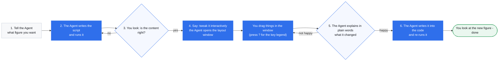

<div align="center">


# mpltweak

**Lay out matplotlib figures the way you arrange slides in PowerPoint, then write the numbers back into your code.**

[](https://pypi.org/project/mpltweak/)
[](https://pypi.org/project/mpltweak/)
[](LICENSE)
[](https://github.com/shdbl/mpltweak/actions/workflows/tests.yml)

[中文](https://github.com/shdbl/mpltweak/blob/main/README.md) | **English**

Docs linked from this file (`docs/*.md`) are currently written in Chinese.

</div>

## Contents

- [1. What problem it solves](#1-what-problem-it-solves)
- [2. Demo](#2-demo)
- [3. 5-minute quick start](#3-5-minute-quick-start)
- [4. Install + quick start](#4-install--quick-start)
- [5. Using it with Agents](#5-using-it-with-agents)
- [6. Workflow](#6-workflow)
- [7. Is it reliable?](#7-is-it-reliable)
- [8. Key map](#8-key-map)
- [9. Edit numbers in place, or insert a layout block](#9-edit-numbers-in-place-or-insert-a-layout-block)
- [10. Three verification layers](#10-three-verification-layers)
- [11. Execution boundaries: which commands run your script](#11-execution-boundaries-which-commands-run-your-script)
- [12. Can it help with your script? Two questions](#12-can-it-help-with-your-script-two-questions)
- [13. Params file](#13-params-file)
- [14. Development](#14-development)
- [15. License](#15-license)

---

## 1. What problem it solves

When you lay out a multi-panel figure, the trouble is usually the layout rather than the data: move one subplot and the neighbouring axis label is covered; increase a font size a little and the legend overlaps a curve. And every change means re-running the script and looking at the figure again.

**What mpltweak does**: you drag panels the way you arrange pictures in PowerPoint, and then those few numbers go back into your source code.

| Approach | Flow |
|---|---|
| **Traditional** | change a number → re-run the script → wait tens of seconds → look at the PNG → still wrong → change again |
| **mpltweak** | open the window → drag into place → `mpltweak apply --write` → those numbers are back in the code |

**Writing back is deterministic.** AST-based location; write-back takes one of two forms: **when the code holds literals, those numbers are edited directly** (no insertion of any kind); **otherwise a self-contained layout block is inserted** (no added import, no change to your own logic). Both forms go through three verification layers (syntax / re-run / semantic); if any layer does not pass, the file is **rolled back by default** (`--keep-unverified` keeps the write-back, and then you must check it yourself), with the backup left in `.tweak_params/<script>.tweak.bak`.

**Changing source code requires determinism**; that is the premise mpltweak is built on.

**It only handles style and position; it does not invent content**: text, data and graphics are still decided by your code.

> If you write figures with an Agent (have an agent read the layout, propose a plan, write back), go to [Using it with Agents](#5-using-it-with-agents).

---

## 2. Demo

<table>
<tr>
<td width="50%"><br>
<b>Drag + edge snapping</b><br><sub>A ghost preview and alignment guides appear while dragging; near an alignment position it snaps</sub></td>
<td width="50%"><br>
<b>Multi-select align / distribute</b><br><sub>Ctrl-click three panels → left align + vertical distribute</sub></td>
</tr>
<tr>
<td><br>
<b>Font size on hover</b><br><sub>Hover a title, axis label, tick label or legend and press <code>+</code> / <code>-</code></sub></td>
<td><br>
<b>Wireframe mode for speed (space bar)</b><br><sub>Full redraw of a cartopy world map <b>494ms → 169ms</b>, so dragging keeps up</sub></td>
</tr>
</table>

**Gestures (similar to PowerPoint):** drag panels, Ctrl multi-select, align / distribute (Ctrl+Shift+L/R/T/B/C/M, H/V), edge snapping (with guides), Ctrl+F fit canvas and trim margins, space bar for wireframe mode, hover to change font size, legend snapping to 8 standard positions, colorbar length / thickness.

---

## 3. 5-minute quick start

Every command below runs in a **terminal** — on Windows cmd / PowerShell, on macOS / Linux Terminal,
and in PyCharm the bottom **Terminal** panel (**not** the Python Console / interactive interpreter).
`cd` into the folder that holds your script before you start.

```bash
cd your-folder          # ← replace with the folder that holds fig1.py (copy the whole line)
```

**What it will do (up front)**: it will **run your script once**, then show the figure in a window you can drag around. It uses your own environment and your own data; **mpltweak itself does not go online and does not change your files** — **until you close the window, your `.py` has not changed by a single character**. Whatever you drag lands in `.tweak_params/fig1.json`; whether and when to write it back is up to the two commands further down. (Which library to install, plus the names and troubleshooting around windows, is under the "Window backend" section of "Install + quick start" and in [docs/interaction.md](https://github.com/shdbl/mpltweak/blob/main/docs/interaction.md).)

You do not have to read this README to use it; go through the steps below once and you will see the result. `fig1.py` is the example script from step 1 of "Install + quick start" further down — **save that code block as `fig1.py` first**, then:

| Step | Command | What you will see |
|---|---|---|
| **1 · Install** | `pip install mpltweak`<br>`pip install "mpltweak[qt]"` | the core package plus whichever graphics library lets the figure open in a window (which one, and the difference, is under "Window backend" below); command-line-only use (`describe` / `check` / `apply`) skips the second line |
| **2 · Open the window and drag** | `mpltweak fig1.py` | the layout window: **drag** panels, drag **edges / corners** to resize, **hover text** and press `+` / `-` for font size, **space** for wireframe speed, **Ctrl+F** to trim margins; press **`?`** for the full key map |
| **3 · Close the window** | —— | the script has **not changed by a single character**; the params land in `.tweak_params/fig1.json` (open the window again to keep adjusting). If you **really dragged something**, closing the window prints the next command for you to copy (`mpltweak apply fig1.py --write`) — nothing to memorise |
| **4 · See what it intends to change** | `mpltweak apply fig1.py` | a per-axis list of positions and font sizes, plus whether it will **edit a number / insert a layout block / refuse**; read-only: it does not execute the script and writes no file |
| **5 · Write back** | `mpltweak apply fig1.py --write` | **three stages: preview (read-only, does not run the script) → you decide → write back**; the write-back **backs the file up** (`.tweak_params/fig1.tweak.bak`), reports success in **one line** (`N edits written in place; figure updated` — add `-v` for the per-field list), and **one command undoes it** (`mpltweak revert fig1.py --write`). The **"numbers only"** real sample is in step 4 of "Install + quick start" |
| **6 · Re-run and look** | `python fig1.py` | the figure looks the way you dragged it; not happy? `mpltweak revert fig1.py --write` goes back to before the write-back (without `--write` it is a preview) |

A sample of **one real write-back** is in step 4 of "Install + quick start" below — that is the "numbers only" case: how many axes and how many edits you actually see depends on your script, and if the script has fields the source does not mention (line width / colour, say), it appends one self-contained layout block at the end of the file, says so in the output, and prints the backup path.

**The write-back has three stages**: `mpltweak apply fig1.py` is the **preview** (read-only — it does not run the script and writes no file) → you look and decide → only then `--write`. The write-back **makes a backup** (`.tweak_params/fig1.tweak.bak`), reports success in **one line** (only the write-back knows how many fields it touched, so that line carries "N edits written in place; figure updated"; the per-field list / backup path / per-layer verdicts need `-v`), and **one command undoes it**: `mpltweak revert fig1.py --write` (without `--write` that is a preview).

**Built the figure with `plt.subplots()` / `GridSpec`?** Then the source often has no number you can edit directly — so it **appends one marked block of code** at the end of the file, and **`mpltweak revert fig1.py --write` takes it away again**; the code you wrote is not rewritten.

**No window?** Check three things, in order:

1. Does the script end with `input()` / wait for you to type? Both the window and the re-run will sit there — comment that line out for now.
2. Does the script take arguments (the kind you normally run as `python fig1.py --data x.npz`)? Pass them through after `--`: `mpltweak fig1.py -- --data x.npz`.
3. Still nothing: paste the whole output to your Agent and ask what the problem is.

If none of the three fits, see [docs/troubleshooting.md](https://github.com/shdbl/mpltweak/blob/main/docs/troubleshooting.md) (dragging does nothing / the panel snaps back / an error — each one is "symptom → the reason in one line → what to do").

**Want to know whether it can help with your script before you start?** Read "[12. Can it help with your script? Two questions](#12-can-it-help-with-your-script-two-questions)" — two questions and you have an answer.

---

## 4. Install + quick start

Every command below runs in a **terminal** — on Windows cmd / PowerShell, on macOS / Linux Terminal,
and in PyCharm the bottom **Terminal** panel (**not** the Python Console / interactive interpreter).
`cd` into the folder that holds your script first:

```bash
cd your-folder          # ← replace with the folder that holds fig1.py (copy the whole line)
```

```bash
pip install mpltweak            # core: describe / check / apply (mcp is an optional adapter layer, see "layout interface for AI / agents")
pip install "mpltweak[qt]"      # add this if you want to **drag figures in a window** (installs the PyQt5 backend)
```

Opening a window needs a graphics backend (PyQt5 recommended, about +150MB), hence the two steps: server / headless / agent-only use cases only need `describe` / `check` / `apply` and should not install a whole Qt stack for it (some environments already ship PySide6 / PyQt6). The official Python installers for Windows / macOS bundle `tkinter`, so `pip install mpltweak` alone usually opens a window; in that case it uses the **Tk backend (reduced interaction)**, which is neither an installation failure nor a broken install. With no backend at all, opening the window exits with `rc=4` and prints which one to install. Backend comparison, probing order and common problems: [docs/interaction.md](https://github.com/shdbl/mpltweak/blob/main/docs/interaction.md); command execution boundaries: [docs/exec-boundaries.md](https://github.com/shdbl/mpltweak/blob/main/docs/exec-boundaries.md).

### Window backend: Qt (recommended) or Tk (default)

`mpltweak[qt]` gives Qt (richest interaction); with only the core package you get Tk (reduced: it opens a window, but some gestures are missing); with neither backend, opening a window exits with `rc=4` and prints which one to install.
Backend comparison table, per-platform installs and probing order: [docs/interaction.md](https://github.com/shdbl/mpltweak/blob/main/docs/interaction.md).

### 1 · Your existing script, unchanged

```python
# fig1.py -- ordinary matplotlib, nothing added
import matplotlib.pyplot as plt
import numpy as np

fig = plt.figure(figsize=(10, 8))
x = np.linspace(0, 1, 200)

ax1 = fig.add_axes([0.08, 0.66, 0.30, 0.21])      # the position is these numbers
ax1.plot(x, np.sin(6 * x))
ax1.set_title('(a)')

ax2 = fig.add_axes([0.11, 0.38, 0.30, 0.21])      # hand-written numbers, usually uneven
ax2.scatter(np.random.rand(60), np.random.rand(60), s=8)

ax3 = fig.add_axes([0.05, 0.08, 0.30, 0.21])
ax3.hist(np.random.randn(300), bins=20)

fig.savefig('fig1.png', dpi=150)
```

No `import mpltweak`, no hooks.

### 2 · Open the layout window

```bash
mpltweak fig1.py
```

> Subcommands: `launch` / `apply` / `revert` / `describe` / `check` / `schema` / `mcp` / `doctor`.
> `mpltweak fig1.py` and `mpltweak launch fig1.py` are equivalent; apart from that, the first argument is always interpreted as a **script path**.

In the window: **drag** panels to move them, drag **edges / corners** to resize, **Ctrl-click** to select several panels → `Ctrl+Shift+L` left align / `Ctrl+Shift+V` vertical distribute, **hover text** and press `+` `-` to change font size, **space** for wireframe (faster on heavy figures), **Ctrl+F** to trim margins. Press **`?`** at any time for the key help page; the key table and workflow diagram are in [docs/interaction.md](https://github.com/shdbl/mpltweak/blob/main/docs/interaction.md).

**Close the window when you are done.** The script has not changed by a single character at this point; the params land in `.tweak_params/fig1.json`.

### 3 · See what it intends to change (read-only)

```bash
mpltweak apply fig1.py
```

It prints the position and font-size inventory of every axis, and writes no file.

### 4 · Write back

**The write-back has three stages: preview (read-only, does not run the script) → you decide → write back.** The write-back **makes a backup** first (`.tweak_params/fig1.tweak.bak`), reports success in **one line** (how many fields + the figure is updated), and **one command undoes it**: `mpltweak revert fig1.py --write` (without `--write` that is a preview).

```bash
mpltweak apply fig1.py --write
```

```text
  正在验证（子进程重跑脚本，最长 300s）
[OK] wrote back 3 edit(s) in place (fig1.py); figure updated (re-run + semantic check passed)
```

The block above is the output of **one real write-back** (paths are shown without their directory prefix; you will see absolute paths); "re-run / semantic verification" re-runs the script **in your environment** (if it cannot run, or the semantics do not match, the file is rolled back; see "Three verification layers").
**On language**: the first line is written in **Chinese** by the current version regardless of `--lang`; the result line follows the interface language.

For the **per-field list / backup path / per-layer verdicts**, add `-v` (success-path detail lives there; failures and downgrades are printed without `-v` too):

```text
[OK] Written back in place: fig1.py
  3 in-place edits: ax0.pos, ax1.pos, ax2.pos
  backup: .tweak_params/fig1.tweak.bak
  [OK] Agg re-run check passed
  [OK] Semantic check passed (target figure matches params)
```

**If your script takes its own arguments** (depends on `sys.argv`, e.g. `python fig1.py --data x.npz`): put them after `--`; the write-back's re-run verification passes them through to the script unchanged, so the re-run matches your baseline and is not mis-rolled-back:

```bash
mpltweak apply fig1.py --write -- --data x.npz --level 3
```

Built the figure with `plt.subplots()` / `GridSpec` (or `constrained_layout`)? Then the source usually has no number you can edit directly — so it **appends one marked block of code** at the end of the file, and **`mpltweak revert fig1.py --write` takes it away again**; the code you already wrote is not rewritten.

When the code holds literals it edits only the numbers inside `add_axes([...]`; otherwise it inserts a self-contained layout block. If any verification step fails, the file is rolled back.

### 5 · Re-run and look

```bash
python fig1.py
```

### If nothing happens

No window, no change after write-back, or wondering where the params come from: see "If nothing happens" in [docs/interaction.md](https://github.com/shdbl/mpltweak/blob/main/docs/interaction.md) (a per-symptom table covering `doctor`, `--timeout 600`, `--force-resume`, layout-engine conflicts and more).

If you are stuck, see [docs/troubleshooting.md](https://github.com/shdbl/mpltweak/blob/main/docs/troubleshooting.md) (the three most common problems: nothing happens when you drag / a layout engine overwrites your position / how to read an error), each written as *symptom -> one-line cause -> what to do*.

---

## 5. Using it with Agents

**You do not need to know any command line — just hand this to an Agent.** (Or type the commands yourself: dragging gets it right, and **you never hand-write those position numbers**.)
(It has to be one that can read and write files on your machine directly; a plain web chat window cannot.)

Send this link to the Agent you already use (Claude / ChatGPT / Cursor / DeepSeek — anything that can read and write files on your machine), and it will set itself up and do the tweaking for you:

- **Operating manual for the Agent**: https://github.com/shdbl/mpltweak/blob/main/skills/mpltweak/SKILL.md
  (If your Agent cannot reach the internet: ask it to open `skills/mpltweak/SKILL.md` in this repository, or paste that file's content to it.)

### The recommended flow: six steps (just talk to your Agent)

1. **Ask the Agent to draw the figure.** You only say what you want ("plot these two groups as a comparison bar chart"); the Agent writes the script and runs it.
   *What you see*: the Agent shows you the figure it drew.
2. **First check that the content is right** (do not start on the layout yet). Are the axes, labels and data what you meant? If not, say so now.
   *What you see*: a finalised version of the content — from here on you are only tweaking layout, not what is drawn.
3. **Tell the Agent "I want to tweak it interactively".** It opens the layout window itself (you install nothing and type no commands).
   *What you see*: a window pops up with your figure in it, ready to drag and zoom.
4. **You make the changes in the window.** Drag panels and legends, adjust font sizes, align, space evenly (press `?` in the window to bring up the full key legend at any time).
   *What you see*: a translucent preview while dragging; the change lands when you let go.
5. **The Agent tells you in plain words what it changed and waits for your confirmation.** For example: "panel (a) moved slightly to the right; title font size 12 → 14". At this point **nothing in your code has changed yet** — if you disagree, keep talking and it keeps adjusting.
   *What you see*: a plain-language list of what changed + one question: "shall I write it into the code?"
6. **Only after you say yes does the Agent write the change into the code, and then re-run it for you.** Compare the re-run against step 2 to make sure nothing was broken.
   *What you see*: the new figure plus which spots changed; if you are not happy, keep tweaking, or ask it to undo the last write-back (`revert`).

> **You never open a command line and never memorise a command** — you look at figures and talk.



**Technical pointers (all in `docs/`)** — MCP (the optional adapter layer) and the JSON contract, **the three read → modify → write → check commands**, the table of the four subcommands with exit-code semantics, the parameter signatures of the four MCP tools, **the ways humans and agents split the work**, and **the layout-engine conflicts to look at before touching the layout** — all of them: [docs/agent.md](https://github.com/shdbl/mpltweak/blob/main/docs/agent.md).

---

## 6. Workflow

```mermaid
flowchart TD
    A["fig1.py<br/>plain matplotlib, no edits needed"]:::script
    B(["interactive window<br/>drag · align · snap · font size"]):::win
    C[".tweak_params/fig1.json<br/>params written quietly, code untouched"]:::script
    P["read-only preview:<br/>which numbers in place / block or not / refuse or not"]:::check
    D{"per-field decision"}:::check
    D0(["【equal】no_change<br/>not one byte touched"]):::ok
    D1["【in place】replace those numbers<br/>everything else byte-identical"]:::script
    D2{"is the insertion point legal?<br/>(before the last savefig / show)"}:::check
    D2b{"can the target object in the block<br/>be proven statically?<br/>(variable name, not fig.axes[i])"}:::check
    D3["【append】insert a self-contained layout block"]:::script
    D4["【refuse】not one byte touched<br/>state the reason + print a paste-ready snippet"]:::bad
    PASTE(["you paste those lines by hand<br/>(replacing placeholders with your variable names)"]):::win
    E{"verification<br/>default: syntax + re-run + semantic<br/>--verify-fast: ast.parse only"}:::check
    F(["commit the change + keep a backup"]):::ok
    G(["roll back to the pre-batch state"]):::bad
    R(["revert: back to the file before the write-back"]):::ok

    A -->|mpltweak fig1.py| B
    B -->|close the window| C
    C -->|apply (without --write)| P
    P -->|after you confirm: apply --write| D
    D -->|target value == current source value| D0
    D -->|literals exist| D1
    D -->|none| D2
    D2 -->|illegal| D4
    D2 -->|legal| D2b
    D2b -->|provable| D3
    D2b -->|not provable| D4
    D1 --> E
    D3 --> E
    E -->|pass| F
    E -->|fail| G
    D4 --> PASTE
    PASTE -.->|run the read-only preview again later| P
    F -.->|second thoughts| R

    classDef script fill:#F7F8FA,stroke:#C9D1DB,stroke-width:1.4px,color:#16181D
    classDef win fill:#2F6FEB,stroke:#2F6FEB,stroke-width:1.6px,color:#FFFFFF
    classDef check fill:#F5F8FF,stroke:#2F6FEB,stroke-width:1.6px,color:#16181D
    classDef ok fill:#EAF7EF,stroke:#2E9E5B,stroke-width:1.4px,color:#16181D
    classDef bad fill:#FEF3E2,stroke:#D97706,stroke-width:1.4px,color:#16181D
```

From opening the window through `mpltweak apply --write`, the script does not change by a single character at any intermediate step (including after the window is closed); the write-back is the action you explicitly approve in step three.

---

## 7. Is it reliable?

**Only measured numbers, each with its denominator.** Finished lines carry their measured
value, filled in from log line numbers — nothing is estimated or invented.
Full version (denominators, per-family tables, block channel, window interaction):
[docs/reliability.md](https://github.com/shdbl/mpltweak/blob/main/docs/reliability.md).

| Layer | Denominator (basis) | Measured |
|---|---|---|
| ① Static: real plotting-code corpus | 10,158 public plotting scripts (static judgement, not executed) | **97.8% written back in place (3,531 / 3,610)**; broken promises **0** |
| ② Runtime: re-run verification after write-back | pool **1,837** → **1,780** runnable | **928 written back and verified** (each of the four laws 928/928); broken promises **0** |
| ③ Window interaction: off-screen matrix | **declared: 12 figure kinds x 1,000 = 12,000**; the ⑫ "multi-figure script" holds two sub-figures (1,000 each) — **13,000 ops actually run** | **ALL PASS on both console encodings (UTF-8 414.3s / GBK 466.8s)**; targeted assertions **356 applicable / 356 passed / 0 failed**; invariants checked after every op, **0 failures** |
| ③ Window interaction: real window | 6 figure kinds x 1,000 gestures = **6,000** gestures + **27 hard assertions** | **27/27 passed** (Qt 25/25, Tk 2/2) |

- The static layer really takes public plotting scripts and decides where the edits land:
  of 4,101 sites, 3,531 were written back in place, 7 were deliberately refused, 37 were
  rejected as invalid parameters and 3 fell back to an appended block — **never once did it
  claim an edit it did not make**.
- The interaction layer is judged by invariants under random operations — **no crash /
  round-trip consistency (undo-redo) / legal geometry / landing matches the params** —
  measured on an off-screen matrix (13,000 ops, invariants checked after every operation,
  0 failures; 356 targeted assertions applicable and all passing, 47 not-applicable cases
  each carry a reason; the assertion machine was self-checked 6/6: break a criterion and the assertion must go red) and on a real
  window (6,000 gestures, 27 hard assertions all passing).

> Note: the linked sub-documents under `docs/` are currently written in Chinese.
> How these experiments are designed (four evidence layers, window-interaction design, criteria tiers, known design limits, denominators) is written up in [docs/reliability.md](https://github.com/shdbl/mpltweak/blob/main/docs/reliability.md).

---

## 8. Key map

| Action | Effect |
|---|---|
| **`?`** | **open / close the key help overlay** (Esc closes it, L toggles Chinese/English) |
| Drag a panel / drag an edge or corner | move / PowerPoint-style resize (opposite edge fixed; aspect-locked axes keep their ratio) |
| **Ctrl+click** (or Shift+click) | add to / remove from the selection; drag on empty space for a rubber-band selection |
| **Ctrl+Shift+L/R/T/B/C/M** | align: left / right / top / bottom / horizontal centre / vertical centre |
| **Ctrl+Shift+H / V** | distribute: horizontal / vertical (ends fixed, equal gaps between) |
| **Ctrl+Z** / **Ctrl+Y** (or Ctrl+Shift+Z) | undo / redo |
| Hover text, then `+` / `-` | font size of title, axis label, tick labels, legend, colorbar |
| **Space** | wireframe mode (borders and text only, data artists hidden) |
| **Ctrl+F** | fit canvas to content (trims margins; subplot pixel size unchanged) |
| **Arrow keys** / Shift+arrow | move a panel (PowerPoint habit) / nudge size (centre fixed) |
| Drag a colorbar long-axis end / thin edge / middle | length / thickness / translate the whole bar |
| Drag a legend | preview of 8 standard positions + snap on release |
| `[` `]` · `c` · `C` · `g` · `s` · `x` `y` | line width / line colour / colormap / grid / spines / linear-log axes |
| `n` · `e` | snapping toggle / manual export |
| Drag the window edge | change canvas size (writes back `figsize`) |

---

## 9. Edit numbers in place, or insert a layout block

Write-back takes **two paths**: when the source holds **literals** it **edits those numbers**; when the position comes from `plt.subplots()` / `plt.subplot(1,2,n)` / `GridSpec` (there is no number in the source to edit) it **inserts a self-contained layout block**. **Whether a block can land depends on whether the target can be statically proven**: if it cannot, `applied=false`, **nothing is written**, and you only get a paste-ready snippet.

Take `fig1.py`. **Before** (hand-written numbers, usually uneven):

```python
ax1 = fig.add_axes([0.08, 0.66, 0.30, 0.21])
ax2 = fig.add_axes([0.11, 0.38, 0.30, 0.21])
ax3 = fig.add_axes([0.05, 0.08, 0.30, 0.21])
```

**After you drag** (the result of `mpltweak apply --write`):

```diff
-ax1 = fig.add_axes([0.08, 0.66, 0.30, 0.21])
+ax1 = fig.add_axes([0.08, 0.655, 0.300, 0.215])
-ax2 = fig.add_axes([0.11, 0.38, 0.30, 0.21])
+ax2 = fig.add_axes([0.08, 0.380, 0.300, 0.215])
-ax3 = fig.add_axes([0.05, 0.08, 0.30, 0.21])
+ax3 = fig.add_axes([0.08, 0.085, 0.300, 0.215])
```

The code holds literals, so **only those numbers moved**: no line added, no `import`, no dependency. The same holds for font sizes, legend position, grid and colorbar: what changes is parameters your code already had.

For figures whose positions come from `subplots` / `GridSpec`, the inserted block looks like this (one real write-back on a 2x2 grid; the first two lines and the closing marker line are verbatim, repeated per-axis lines are elided with `# …`):

```python
# ===== auto layout (generated) - do not edit inside =====
# auto-generated by mpltweak at 2026-10-12 19:42 (feel free to tweak; keep the marker lines above and below)
# 轴身份（调图时）：ax0=网格[2, 2, 0, 0]，ax1=网格[2, 2, 0, 1]，ax2=网格[2, 2, 1, 0]，ax3=网格[2, 2, 1, 1]
axes[0, 0].set_position([0.1450, 0.5500, 0.3723, 0.3700])
axes[0, 0].title.set_fontsize(14)
axes[0, 0].lines[0].set_linewidth(1.5)
# … the other three axes each get the same kind of lines (position / title / lines)
# ===== end auto layout =====
```

**On language**: the `# 轴身份（调图时）：…` line inside the block is written in **Chinese** by the current version regardless of `--lang` (it records which grid cell each axis was while you were laying out the figure) — a Chinese line inside an otherwise English sample is expected, not a mistake. The other block lines (including the generated-at line above it) follow the interface language.

Those two marker lines are **written into your script**; `grep auto layout` finds the block. The block is **self-contained** (no added `import`, nothing beyond matplotlib, no change to your logic); a repeated write-back **replaces it as a whole**. To force one path only: `--style inplace` (no block is inserted; a field that cannot be written in place fails with `rc=1`) or `--style block` (always inserts a block). **Why the block is written that way, and the trade-offs (pinning the whole state into your source), are in [docs/verify.md](https://github.com/shdbl/mpltweak/blob/main/docs/verify.md).**


---

## 10. Three verification layers

1. **Syntax layer** (`layers.syntax`): after writing to disk, an unconditional `ast.parse` on both paths (in-place and block); a syntax error rolls back to the pre-batch state on the spot.
2. **Re-run layer** (`layers.rerun`): a headless Agg re-run; a non-zero exit code is then classified as "the script could not run in the first place" versus "the write-back broke it".
3. **Semantic layer** (`layers.semantic`): after the re-run it dumps the target figure state and compares it field by field against the params (position / font sizes / `grid` / `spines` / `clim` and others); when a field cannot be judged, `verified=null` and `detail` lists the fields that were not judged.

If any layer does not pass, the file is rolled back to the pre-batch state; the pre-write original is backed up in `.tweak_params/<script>.tweak.bak`. Per-layer details and how they relate to `--verify-fast` / `--keep-unverified`: [docs/verify.md](https://github.com/shdbl/mpltweak/blob/main/docs/verify.md).

### Speed and gates: `--verify-fast` and `--strict`

**`--verify-fast` (speed)**: only the `ast.parse` after writing, so it is fast; it does not show that the script runs, nor that the layout landed on the target figure (JSON reports `verify_mode: "fast"`).
**`--strict` (gate)**: `check --strict` upgrades layout-engine conflicts (`constrained_layout` / `autolayout`) from a note to a problem (`rc=1`); `apply --write --strict` refuses to write back when a conflict exists (add `--allow-layout-conflict` to let it through). The `ok` field plus exit code of `check --json` works as a CI case directly; `check` accepts one script at a time, so batching needs a loop of your own.
Other details (the boundary of `--no-verify`, the `bbox_inches='tight'` downgrade, `--tol` accepting finite positive numbers only, the `--static` gate, a batch script example): [docs/verify.md](https://github.com/shdbl/mpltweak/blob/main/docs/verify.md).

### Second thoughts: `mpltweak revert`

Wrong write-back, or you liked the earlier version better? No need to dig through backups:

```bash
mpltweak revert fig1.py            # preview only: which lines would change back (default, code untouched)
mpltweak revert fig1.py --write    # actually go back to "before the last write-back"
```

It uses the backup **next to the params file** (by default `.tweak_params/<script>.tweak.bak`, written automatically before every `apply --write`). If the write-back used `--params`, the revert needs the same `--params`, otherwise it reports `[revert] no backup to revert to` (`rc=2`).
It reverts the **most recent** write-back: the backup is overwritten on each write-back, so after several write-backs a revert no longer reaches the earliest original.
**The revert itself is reversible**: before overwriting, the current version is saved as `<script>.revert.bak` (also next to the params file), so an accidental revert can be undone.
Restoring is a **byte-for-byte copy** (BOM / line endings / encoding untouched).

---

## 11. Execution boundaries: which commands run your script

`describe` / `check` / opening the window **execute** your script (in a **subprocess**, headless Agg; the exit code and any global state stay inside that subprocess). `apply` only rewrites the AST, unless you ask for **re-run verification** (after `--write` it re-runs once by default; `--verify-fast` only does `ast.parse`).

Exit-code semantics, the effect of a script calling `sys.exit()` itself, and the CI usage of `--strict`: [docs/exec-boundaries.md](https://github.com/shdbl/mpltweak/blob/main/docs/exec-boundaries.md).

**A pre-flight runs before the write-back (0.1.10)**: when verification is about to re-run your script, `apply --write` and the window launcher take a **static** look at the source (**never executing it**). If they spot “missing dependency / needs arguments / network / waits for input / pops a window”, you get one short heads-up plus a copy-pasteable next step (top-level `preflight.risks[]` under `--json`). A clean script stays completely silent; if the pre-flight itself trips it gets out of the way and never blocks the write-back or the window. The five checks and the JSON fields are in [docs/exec-boundaries.md](https://github.com/shdbl/mpltweak/blob/main/docs/exec-boundaries.md).

---

## 12. Can it help with your script? Two questions

**Answer two questions first**:

1. **Can your script run on its own, with nobody watching?** No clicking, no typing, no window on screen — the write-back's verification **really runs your script** in a **headless** environment, and there is nobody there to help it along.
2. **Does it need network, a password, or a very large file?** If so, do not use write-back.

If both pass, it is probably a good fit. **The only real threshold: can it run headlessly, unattended?**

| Script property | What happens |
|---|---|
| Reads large data / needs a heavy environment / needs network or credentials | the headless re-run stalls or fails → the write-back is rolled back |
| Needs human input midway (`input()`, interactive choices) | the headless re-run blocks → the write-back is rolled back |
| A figure that is only meaningful under a specific interactive backend | verification always uses the headless Agg backend |

Such scripts take the read-only route (`mpltweak describe` / `mpltweak check`, neither writes back), or you edit the code by hand.
Its target users are **small and medium research plotting scripts that run locally**.

> The mechanics of verification are in [docs/verify.md](https://github.com/shdbl/mpltweak/blob/main/docs/verify.md).
> The concentrated version of the boundaries and the exact wording behind every number (when it does not apply / execution boundaries / exit codes / what verification does not claim / corpus denominators) is in [docs/boundaries.md](https://github.com/shdbl/mpltweak/blob/main/docs/boundaries.md).

---

## 13. Params file

The params file is a **public format**: you can edit it by hand, or let an Agent generate it, and `--write` applies it either way. The top-level `version` marks the format version (currently 4):

```jsonc
{ "version": 4, "script": "fig1.py",
  "axes": [ { "index": 0, "pos": [0.048, 0.655, 0.30, 0.215], "title_fontsize": 9.0 } ] }
```

**Only fields given explicitly are written**: a field absent from the params is not written back. The field table (`figsize_px` / `figsize_in` / `aspect_locked` / `cell` / `clim` / `cmap` / `lines` / `legend` / `tick_fontsize_y` ...) and the two conventions (`axes[i]` order, colorbar slot axes not taking an index): [docs/params.md](https://github.com/shdbl/mpltweak/blob/main/docs/params.md).

---

## 14. Development

Repository layout: `src/mpltweak/` (`cli.py` / `launch.py` / `toolbox.py` / `params.py` / `apply.py` / `writeback.py` / `verify.py`). Run the tests: `python tests/test_writeback.py` (AST write-back + three verification layers). The rest (installation, the full test command list, module responsibilities, the embedding API `from mpltweak.toolbox import gaitu`) is in [docs/dev.md](https://github.com/shdbl/mpltweak/blob/main/docs/dev.md).

---

## 15. License

MIT
