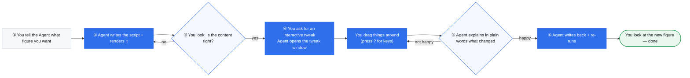

<div align="center">


# mpltweak

**Lay out matplotlib figures the way you arrange slides in PowerPoint, then write the numbers back into your code.**

[](https://pypi.org/project/mpltweak/)
[](https://pypi.org/project/mpltweak/)
[](LICENSE)
[](https://github.com/shdbl/mpltweak/actions/workflows/tests.yml)

[中文](https://github.com/shdbl/mpltweak/blob/main/README.md) | **English**

</div>

## What problem does it solve

When you lay out a multi-panel figure — several subplots side by side on one canvas — the pain is usually layout, not data: nudge one subplot and its neighbour's tick labels get covered; bump the font size and the legend lands on the curve. And every change costs a script re-run and another look at the PNG.

**What mpltweak does**: you drag panels the way you drag pictures around in PowerPoint, and then it writes those few numbers back into your source. It only touches **style and position — it never invents content**. The text, the data and the marks remain entirely yours.

**Zero intrusion**: it does not edit your code, does not add an `import`, and does not produce side files — the parameters you drag out live in `.tweak_params/fig1.json`. **Your `.py` changes only when you explicitly ask it to write back.**

| Way | Loop |
|---|---|
| **Traditional** | change a number → re-run the script → wait → look at the PNG → still wrong → change again |
| **mpltweak** | open the window → drag into place → **have it write those numbers back into the code** |

Demos:

<table>
<tr>
<td width="50%"><br>
<b>Drag + edge snapping</b><br><sub>a ghost preview and alignment guides while dragging; it snaps when you get close</sub></td>
<td width="50%"><br>
<b>Multi-select align / distribute</b><br><sub>Ctrl-click three panels → align left + distribute vertically</sub></td>
</tr>
<tr>
<td><br>
<b>Hover to change font size</b><br><sub>hover a title, axis label, tick label or legend and press <code>+</code> / <code>-</code></sub></td>
<td><br>
<b>Wireframe mode (space)</b><br><sub>full redraw of a cartopy global map: <b>494 ms → 169 ms</b>, dragging stays smooth</sub></td>
</tr>
</table>


## Two routes, pick one

mpltweak ships a **manual (Skill) written for AI agents**: hand that manual to an agent that can read and write files on your machine and it will type every command for you. So there are two routes — **same tool, same Skill**; the only difference is *who types*:

- **Route A: hand it to an Agent** (pick this if the command line is not your thing): you look at the figure and talk. ← **this one comes first**
- **Route B: run the commands yourself**: a handful of commands, ten minutes to a working loop. → [jump to the end](#route-b-run-the-commands-yourself)

## Route A: hand it to an Agent

**You do not need to know the command line — hand the whole thing to an agent.**
(**It has to be an agent that can read and write files on your machine**; one that only chats in a web page will not do.)

**Copy the sentence below straight into the agent you are using** (Claude Code / Codex / Cursor / DeepSeek Harness — anything that can read and write files on your computer):

> Please install the skill at https://github.com/shdbl/mpltweak/blob/main/skills/mpltweak/SKILL.md , then follow its instructions to install mpltweak; once it is set up, run the demo first so I can see the result.

### See it in two minutes (the Agent runs the demo)

Once it is installed, ask it to run the **demo** first: it generates a **sample script** (a four-panel composite figure, plain matplotlib) and opens the tweak window — drag things around, change font sizes, whatever you like. When you close the window it tells you **which things you changed** in plain words and shows you, line by line, **what the code would become**.

If you like it, have it write the changes back into that **sample script**, re-run it, and show you the **before / after** figures.

> Everything happens inside a `mpltweak-demo/` folder in the current directory — **it never touches a script of your own**.

### Day-to-day flow with an Agent

1. **Ask the Agent to draw the figure.** (**If you already have a plotting script and only want to fix the layout, skip to step 3 and tell it the script name, e.g. `fig1.py`.**)
   *What you see*: the Agent pastes the finished figure back to you.
2. **First confirm the content is right** (do not start on layout yet). Are the axes, labels and data what you meant? If not, say so now and let the Agent fix it.
   *What you see*: the version whose content is final — from here on you are only adjusting *layout*, not *what is drawn*.
3. **Say "I want to tweak it interactively".** It opens the tweak window by itself (you install nothing and type nothing).
   *What you see*: a window pops up with your figure in it — drag and zoom with the mouse.
4. **Make your changes in the window.** Drag panels, drag the legend, change font sizes, align, distribute (**press `?` in the window at any time for every key**).
   *What you see*: a translucent preview while dragging; the change lands when you release.
5. **The Agent tells you in plain words what it changed, and waits for your OK.** Something like "panel (a) moved a little to the right, the title font size went from 12 to 14".
   **The code has not moved yet** — disagree and it keeps adjusting.
   *What you see*: a plain-language list of changes plus one question: "write these into the code?"
6. **You say yes; only then does the Agent write the changes back and re-run.** Compare the re-run against step 2 to be sure nothing broke.
   *What you see*: the new figure plus which spots changed; keep iterating, or have it revert to the previous version.

> **You never open a terminal and never memorise a command** — you look at figures and talk.



**Keys in the window (`?` shows all of them at any time)**: drag / multi-select, align / distribute, snapping, `Ctrl+F` to trim margins, space for wireframe speed-up, hover text then `+` / `-` for font size, the 8 standard legend positions, colorbar length / thickness, **`Alt+click` to reach through stacked panels**, **`Tab` to cycle through siblings**. Full list in [docs/interaction.md](https://github.com/shdbl/mpltweak/blob/main/docs/interaction.md).

## How will it change your code? Three outcomes

For every script the outcome is knowable in advance, and there are only three:

| Case | What it does | Result |
|---|---|---|
| **The number is literally in your source**<br>(`fig.add_axes([0.08, 0.66, 0.30, 0.21])`) | **edits that one number in place**, inserts nothing | that line changes, nothing else moves |
| **There is no editable number in the source**<br>(figures built by `plt.subplots()` / `GridSpec`) | **appends one self-contained snippet at the end of the file** — no `import`, none of your logic touched | a block marked `auto layout` appears at the end |
| **It cannot prove which object to edit**<br>(**when the label is not stable it does not guess**: axes built in a loop, axis count not matching the params, a carrier name that is not exactly one module-level call; **figures built inside a function are writable now**) | **writes nothing.** It will not guess an object that "is probably this one" | **your code stays byte-for-byte identical**; you get a locating note an **Agent can act on** (which symbol, change it to what). Full decision table (scope x how axes are built -> writable or not) in [docs/verify.md](https://github.com/shdbl/mpltweak/blob/main/docs/verify.md) |

### 1. Editable in place: the line itself changes

Before:

```python
fig = plt.figure(figsize=(10, 8))
ax1 = fig.add_axes([0.08, 0.66, 0.30, 0.21])
ax1.set_title('(a)', fontsize=12)
```

After:

```python
fig = plt.figure(figsize=(10, 8))
ax1 = fig.add_axes([0.06, 0.68, 0.32, 0.23])   # ← only these numbers change
ax1.set_title('(a)', fontsize=15)              # ← the font size appended on the same line
```

**No lines added, nothing else touched.**

### 2. Not editable in place: one snippet appended at the end

Before (a `subplots` figure; the source holds no number you could edit directly):

```python
fig, axes = plt.subplots(1, 2, figsize=(10, 4))
axes[0].plot(np.arange(5), np.arange(5))
axes[0].set_title('(a)')
axes[1].plot(np.arange(5), np.arange(5) * 2)
axes[1].set_title('(b)')
fig.savefig('fig1.png', dpi=150)
```

After (the block below is real output, verbatim — only the timestamp follows the moment it was generated):

```python
fig, axes = plt.subplots(1, 2, figsize=(10, 4))
axes[0].plot(np.arange(5), np.arange(5))
axes[0].set_title('(a)')
axes[1].plot(np.arange(5), np.arange(5) * 2)
axes[1].set_title('(b)')
# ===== auto layout (generated) - do not edit inside =====
# generated by mpltweak at <time> (fine to tweak - do not delete the two marker lines)
# axis identity (when tweaking): ax0=grid[1, 2, 0, 0], ax1=grid[1, 2, 0, 1]
axes[0].set_position([0.0800, 0.1500, 0.3800, 0.7500])
axes[1].set_position([0.5477, 0.1100, 0.3523, 0.7700])
axes[0].lines[0].set_linewidth(1.5)
axes[0].lines[0].set_color('#1f77b4')
axes[1].lines[0].set_linewidth(1.5)
axes[1].lines[0].set_color('#1f77b4')
# ===== end auto layout =====
fig.savefig('fig1.png', dpi=150)
```

**Not a single line of your own code was rewritten**; if you dislike it, delete the block, or take it back with one command (next section).

### 3. Unprovable: not written, and here is what to do

Before (the axes are built in a loop, so only the runtime knows which axis `fig.axes[i]` is):

```python
fig = plt.figure(figsize=(8, 3))
for i, name in enumerate(['a', 'b', 'c']):
    fig.add_subplot(1, 3, i + 1).plot(np.arange(5), np.arange(5) * (i + 1))
    fig.axes[i].set_title(name)
fig.savefig('fig2.png', dpi=150)
```

What it gives you instead (real output, verbatim, last line shown):

```text
· kept as is: inside the block a target can only be located by a **statically provable variable name**; these fields have none
  (no provable variable name, and the runtime index fig.axes[i] / plt.gcf() would write to a different axis or figure)
  -> fail-closed, nothing written this time: ax0.lines, ax0.pos, ax1.lines, ax1.pos, ax2.lines, ax2.pos
```

**Not one byte of your code changed.** It is not a dead end: that message tells you exactly which spot to change. **The Agent reads it, fixes the script itself, and comes back to tweak the figure** — you neither copy nor relay anything.

## Is it reliable?

**Four guards, from loose to tight:**

1. **As long as you do not ask it to write back, your `.py` stays as it is.** Opening the window, dragging, closing — it only writes parameters into `.tweak_params/`; the code does not move.
2. **You can look before it writes.** Have it show you line by line which lines it would touch and from what to what — look only, change nothing.
3. **A real write-back backs up automatically**, and one command takes you back to the pre-write version.
4. **Anything it cannot prove is left alone**, with the reason spelled out — better that this pass does nothing than a wrong object smuggled into your code.

Every real write-back also passes **three checks**: **syntax** (does the edited script still parse) → **re-run** (does the script actually run again and still produce the figure) → **semantic** (are the positions and font sizes on the figure the ones you dragged). If any check fails it **rolls back automatically**, and you are holding the script you started with.

Measured on **10,158** real scientific plotting scripts, **1,780** real runs and **13,000** random gestures: **zero cases of "said it changed, actually did not".**

(The static-diff corpus is the wider set of **16,126** `.py` files = **10,158 third-party public plotting scripts** + **5,968 of this project's own scaffolding**; for "real user scripts" the denominator is the former only, and the two are never mixed.)

The full sample denominators, criteria and per-family results are in [docs/reliability.md](https://github.com/shdbl/mpltweak/blob/main/docs/reliability.md); unsupported scenarios and non-claims are in [docs/boundaries.md](https://github.com/shdbl/mpltweak/blob/main/docs/boundaries.md).

## Route B: run the commands yourself

### Install

```bash
pip install mpltweak            # core: describe / check / apply
pip install "mpltweak[qt]"      # add this if you want the window (installs the PyQt5 backend)
```

```bash
mpltweak --version      # version
mpltweak --check-update # ask PyPI whether a newer release exists (opt-in network; every other command stays offline)
```

**Exit codes** (for scripting): `0` success / `1` the check found problems **or nothing was written this time** (including fail-closed refusals) / `2` cannot run (script missing, the script itself failed, bad parameters) / `4` no usable GUI backend. All four entry points agree.

`[qt]` provides the PyQt5 backend; `describe` / `check` / `apply` do not need it. Without Qt it falls back to Tk (reduced interaction, the window says so); with no backend at all the window fails and explains why.

> Backend comparison, per-platform installs, `mpltweak doctor` probe order and every open-the-window failure — [docs/interaction.md](https://github.com/shdbl/mpltweak/blob/main/docs/interaction.md).
> Which commands **execute** your script and how exit codes are computed — [docs/exec-boundaries.md](https://github.com/shdbl/mpltweak/blob/main/docs/exec-boundaries.md).

### Demo

```bash
mpltweak demo            # create ./mpltweak-demo/ and open the window; writes nothing
mpltweak demo --write    # write back the sample script + re-run + produce before.png / after.png
```

On closing the window it prints the change list and a line-by-line diff; without `--write` the sample script stays byte-identical. An existing directory is reused, never overwritten.

### Six steps

```
cd into your script directory
```

`fig1.py` (zero intrusion: no `import mpltweak`, no change to any existing code):

```python
# fig1.py —— ordinary matplotlib, nothing special
import matplotlib.pyplot as plt
import numpy as np

fig = plt.figure(figsize=(10, 8))
x = np.linspace(0, 1, 200)

ax1 = fig.add_axes([0.08, 0.66, 0.30, 0.21])      # the position is these numbers
ax1.plot(x, np.sin(6 * x))
ax1.set_title('(a)')

ax2 = fig.add_axes([0.11, 0.38, 0.30, 0.21])      # hand-written numbers, rarely aligned
ax2.scatter(np.random.rand(60), np.random.rand(60), s=8)

ax3 = fig.add_axes([0.05, 0.08, 0.30, 0.21])
ax3.hist(np.random.randn(300), bins=20)

fig.savefig('fig1.png', dpi=150)
```

| Step | Command | What you see |
|---|---|---|
| **1 · install** | `pip install mpltweak`<br>`pip install "mpltweak[qt]"` | core package / plus the PyQt5 backend (only the latter can open the window) |
| **2 · open and drag** | `mpltweak fig1.py` | the tweak window: **drag** a panel to move it, drag its **edges / corners** to resize, **hover text** and press `+` `-` for font size, **space** for wireframe speed-up, **Ctrl+F** to trim margins; press **`?`** for every key |
| **3 · close** | —— | your script is **unchanged, character for character**; parameters land in `.tweak_params/fig1.json` (reopen to keep adjusting). If you really dragged something, closing prints the next command for you to copy |
| **4 · preview** | `mpltweak apply fig1.py`<br>`mpltweak apply fig1.py --diff` | the first lists per-axis parameters plus the "edit in place / append block / refuse" verdict; the second gives a **line-by-line diff** (`{line,type,old,new}`) with `type ∈ inplace / insert_block / replace`. Neither **executes the script or writes a file**; the `--diff` `preview_sha256` equals the sha256 of the real written file (use `preview_sha256_norm` when minutes have passed). Add `--json` for machine-readable output |
| **5 · write back** | `mpltweak apply fig1.py --write` | **atomic write** (temp file + rename) → backup to `.tweak_params/fig1.tweak.bak` → subprocess re-run verification → semantic comparison. Success prints one line; **idempotent** (re-applying the same parameters produces no new diff); undo with `mpltweak revert fig1.py --write` (without `--write` it is a preview) |
| **6 · re-run and look** | `python fig1.py` | the figure is the one you dragged |

**Write-back is deterministic, not guesswork.** It is not a text-level regex substitution (that would mangle an unrelated `0.08`); it parses your script into an **AST (syntax tree)**, locates which call creates the figure and which `Constant` is the position, then binds the target object through variable names. The write is an **AST rewrite with source fidelity** (untouched lines stay byte-identical). **No LLM is involved**: same input, same parameters, same output, every time.

Two channels: **a literal in the source ⇒ edit the constant in place** (no node inserted); **otherwise insert a self-contained `auto layout` block before `savefig`/`show`**. Both channels pass the three checks (**parses → subprocess re-run → semantic comparison**), and any failure **rolls back by default**; the write lands **atomically** (temp file + rename), the backup sits in `.tweak_params/fig1.tweak.bak`, and it is **idempotent** (re-applying the same parameters produces no new diff). `--keep-unverified` keeps an unverified result.

> Want machine-readable output: `--json` gives `files[].diff` (line by line `{line,type,old,new}`), `preview_sha256` (equal to the sha256 of the real written file), `stage` (which step it stopped at), `next_step`, `attribution`. Contract: [docs/agent.md](https://github.com/shdbl/mpltweak/blob/main/docs/agent.md).

> The interface follows your system locale; set `MPLTWEAK_LANG=zh|en` to force one, or pass `--lang en` — it works both **first** (`mpltweak --lang en fig.py`) and **after the subcommand/script path** (`mpltweak fig.py --lang en`), because it is a tool option (`apply`/`describe`/`check`/`launch` alike). To pass `--lang` to **your own script**, separate it: `mpltweak fig.py -- --lang en`.

> Stuck? See [docs/troubleshooting.md](https://github.com/shdbl/mpltweak/blob/main/docs/troubleshooting.md) (dragged and nothing happened / dragged and it snapped back / an error — each entry is "symptom → one-line cause → what to do").
> Full output samples, the `-v` change list, `--style inplace` / `--style block`, and the parameter field table — [docs/verify.md](https://github.com/shdbl/mpltweak/blob/main/docs/verify.md) and [docs/params.md](https://github.com/shdbl/mpltweak/blob/main/docs/params.md).

## License

MIT

---

**The long version:** keys and gestures [docs/interaction.md](https://github.com/shdbl/mpltweak/blob/main/docs/interaction.md) · parameter field table [docs/params.md](https://github.com/shdbl/mpltweak/blob/main/docs/params.md) · frozen `--json` contract [docs/json-contract.md](https://github.com/shdbl/mpltweak/blob/main/docs/json-contract.md) · the three checks, backups and `revert` [docs/verify.md](https://github.com/shdbl/mpltweak/blob/main/docs/verify.md) · stuck [docs/troubleshooting.md](https://github.com/shdbl/mpltweak/blob/main/docs/troubleshooting.md) · measured numbers [docs/reliability.md](https://github.com/shdbl/mpltweak/blob/main/docs/reliability.md) · boundaries [docs/boundaries.md](https://github.com/shdbl/mpltweak/blob/main/docs/boundaries.md) · execution boundaries and exit codes [docs/exec-boundaries.md](https://github.com/shdbl/mpltweak/blob/main/docs/exec-boundaries.md) · the manual for agents [docs/agent.md](https://github.com/shdbl/mpltweak/blob/main/docs/agent.md) and [skills/mpltweak/SKILL.md](https://github.com/shdbl/mpltweak/blob/main/skills/mpltweak/SKILL.md) · development and tests [docs/dev.md](https://github.com/shdbl/mpltweak/blob/main/docs/dev.md)
