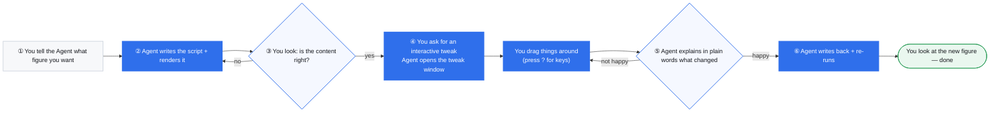

<div align="center">


# mpltweak

**Lay out matplotlib figures the way you arrange slides in PowerPoint, then write the numbers back into your code.**

[](https://pypi.org/project/mpltweak/)
[](https://pypi.org/project/mpltweak/)
[](LICENSE)
[](https://github.com/shdbl/mpltweak/actions/workflows/tests.yml)

[中文](https://github.com/shdbl/mpltweak/blob/main/README.md) | **English**

</div>

## What problem does it solve

When you lay out a multi-panel figure, nudge one subplot and its neighbour's tick labels get covered; bump the font size and the legend lands on the curve. Every change costs a script re-run and another look at the PNG.

**What mpltweak does**: drag panels like pictures in PowerPoint, then write those numbers back into your source. It touches **style and position — it never invents content**.

**Zero intrusion**: it does not edit your code, add an `import`, or produce side files — the parameters live in `.tweak_params/fig1.json`. **Your `.py` changes only when explicitly asked to write back.**

| Way | Loop |
|---|---|
| **Traditional** | change a number → re-run script → wait → look at PNG → still wrong → change again |
| **mpltweak** | open window → drag into place → **write numbers back into code** |

Demos:

<table>
<tr>
<td width="50%"><br>
<b>Drag + edge snapping</b><br><sub>a ghost preview and alignment guides while dragging; snaps when close</sub></td>
<td width="50%"><br>
<b>Multi-select align / distribute</b><br><sub>Ctrl-click three panels → align left + distribute vertically</sub></td>
</tr>
<tr>
<td><br>
<b>Hover to change font size</b><br><sub>hover a title, axis label, tick label or legend and press <code>+</code> / <code>-</code></sub></td>
<td><br>
<b>Wireframe mode (space)</b><br><sub>full redraw of a cartopy global map: <b>494 ms → 169 ms</b>, dragging stays smooth</sub></td>
</tr>
</table>


## Two routes, pick one

mpltweak ships a **manual (Skill) written for AI agents**:

- **Route A: hand it to an Agent**: talk about the figure layout.
- **Route B: run the commands yourself**: → [jump to the end](#route-b-run-the-commands-yourself)

## Route A: hand it to an Agent

**Copy the sentence below into the agent:**

> Please install the skill at https://github.com/shdbl/mpltweak/blob/main/skills/mpltweak/SKILL.md , then follow its instructions to install mpltweak; once it is set up, run the demo first so I can see the result.

### See it in two minutes (the Agent runs the demo)

Ask the Agent to run the **demo**: it generates a **sample script** and opens the tweak window. When you close the window it shows **what the code would become**.

Have it write changes back into the **sample script**, re-run it, and show the **before / after** figures.

### Day-to-day flow with an Agent

1. **Ask the Agent to draw the figure.** (**If you already have a plotting script, skip to step 3 and tell it the script name, e.g. `fig1.py`.**)
2. **First confirm the content is right.**
3. **Say "I want to tweak it interactively".**
4. **Make your changes in the window.** (**press `?` in the window at any time for every key**).
5. **The Agent tells you in plain words what it changed, and waits for your OK.** Something like "panel (a) moved a little to the right, the title font size went from 12 to 14".
6. **You say yes; only then does the Agent write the changes back and re-run.**

> **You never open a terminal and never memorise a command.**



**Keys in the window (`?` shows all of them at any time)**: drag / multi-select, align / distribute, snapping, `Ctrl+F` to trim margins, space for wireframe speed-up, hover text then `+` / `-` for font size, 8 standard legend positions, colorbar length / thickness, **`Alt+click` to reach through stacked panels**, **`Tab` to cycle through siblings**. Full list in [docs/interaction.md](https://github.com/shdbl/mpltweak/blob/main/docs/interaction.md).

## How will it change your code? Three outcomes

Outcome is knowable in advance:

| Case | What it does | Result |
|---|---|---|
| **The number is literally in your source**<br>(`fig.add_axes([0.08, 0.66, 0.30, 0.21])`) | **edits that one number in place**, inserts nothing | that line changes, nothing else moves |
| **There is no editable number in the source**<br>(figures built by `plt.subplots()` / `GridSpec`) | **appends one self-contained snippet at the end of the file** | a block marked `auto layout` appears at the end |
| **It cannot prove which object to edit**<br>(**when the label is not stable it does not guess**: axes built in a loop, axis count not matching the params, a carrier name that is not exactly one module-level call; **figures built inside a function are writable now**) | **writes nothing.** | **your code stays byte-for-byte identical**; you get a locating note an **Agent can act on**. Full decision table in [docs/verify.md](https://github.com/shdbl/mpltweak/blob/main/docs/verify.md) |

### 1. Editable in place: the line itself changes

Before:

```python
fig = plt.figure(figsize=(10, 8))
ax1 = fig.add_axes([0.08, 0.66, 0.30, 0.21])
ax1.set_title('(a)', fontsize=12)
```

After:

```python
fig = plt.figure(figsize=(10, 8))
ax1 = fig.add_axes([0.06, 0.68, 0.32, 0.23])   # ← only these numbers change
ax1.set_title('(a)', fontsize=15)              # ← the font size appended on the same line
```

**No lines added, nothing else touched.**

### 2. Not editable in place: one snippet appended at the end

Before (a `subplots` figure; the source holds no number you could edit directly):

```python
fig, axes = plt.subplots(1, 2, figsize=(10, 4))
axes[0].plot(np.arange(5), np.arange(5))
axes[0].set_title('(a)')
axes[1].plot(np.arange(5), np.arange(5) * 2)
axes[1].set_title('(b)')
fig.savefig('fig1.png', dpi=150)
```

After (verbatim output):

```python
fig, axes = plt.subplots(1, 2, figsize=(10, 4))
axes[0].plot(np.arange(5), np.arange(5))
axes[0].set_title('(a)')
axes[1].plot(np.arange(5), np.arange(5) * 2)
axes[1].set_title('(b)')
# ===== auto layout (generated) - do not edit inside =====
# generated by mpltweak at <time> (fine to tweak - do not delete the two marker lines)
# axis identity (when tweaking): ax0=grid[1, 2, 0, 0], ax1=grid[1, 2, 0, 1]
axes[0].set_position([0.0800, 0.1500, 0.3800, 0.7500])
axes[1].set_position([0.5477, 0.1100, 0.3523, 0.7700])
axes[0].lines[0].set_linewidth(1.5)
axes[0].lines[0].set_color('#1f77b4')
axes[1].lines[0].set_linewidth(1.5)
axes[1].lines[0].set_color('#1f77b4')
# ===== end auto layout =====
fig.savefig('fig1.png', dpi=150)
```

**Not a single line of your own code was rewritten**; delete the block or revert with one command.

### 3. Unprovable: not written, but the Agent is told how to fix it

Before (axes built in a loop):

```python
fig = plt.figure(figsize=(8, 3))
for i, name in enumerate(['a', 'b', 'c']):
    fig.add_subplot(1, 3, i + 1).plot(np.arange(5), np.arange(5) * (i + 1))
    fig.axes[i].set_title(name)
fig.savefig('fig2.png', dpi=150)
```

Output:

```text
· kept as is: inside the block a target can only be located by a **statically provable variable name**; these fields have none
  (no provable variable name, and the runtime index fig.axes[i] / plt.gcf() would write to a different axis or figure)
  -> fail-closed, nothing written this time: ax0.lines, ax0.pos, ax1.lines, ax1.pos, ax2.lines, ax2.pos
```

**Not one byte of your code changed.** This message is addressed to the Agent: it reads the instruction, fixes the script itself, and comes back to tweak the figure**.

## Is it reliable?

**Four guards:**

1. **As long as you do not ask it to write back, your `.py` stays as it is.** Opening, dragging, closing only writes to `.tweak_params/`.
2. **You can look before it writes.** Preview line-by-line changes.
3. **A real write-back backs up automatically**, with one-command rollback.
4. **Anything it cannot prove is left alone.**

Every real write-back passes **three checks**: **syntax** → **re-run** → **semantic**. If any check fails it **rolls back automatically**, returning to the script you started with.

Measured on **10,158** real scientific plotting scripts, **1,780** real runs and **13,000** random gestures: **zero cases of "said it changed, actually did not".**

(The static-diff corpus is **16,126** `.py` files = **10,158 third-party public plotting scripts** + **5,968 of this project's own scaffolding**.)

The full sample denominators, criteria and per-family results are in [docs/reliability.md](https://github.com/shdbl/mpltweak/blob/main/docs/reliability.md); unsupported scenarios and non-claims are in [docs/boundaries.md](https://github.com/shdbl/mpltweak/blob/main/docs/boundaries.md).

## Route B: run the commands yourself

### Install

```bash
pip install mpltweak            # core: describe / check / apply
pip install "mpltweak[qt]"      # add this if you want the window (installs the PyQt5 backend)
```

```bash
mpltweak --version      # version
mpltweak --check-update # ask PyPI whether a newer release exists (opt-in network; every other command stays offline)
```

**Exit codes**: `0` success / `1` check found problems **or nothing was written this time** / `2` cannot run / `4` no usable GUI backend.

`[qt]` provides the PyQt5 backend; `describe` / `check` / `apply` do not need it. Without Qt it falls back to Tk; with no backend at all the window fails.

> Backend comparison, per-platform installs, `mpltweak doctor` probe order and open-the-window failure — [docs/interaction.md](https://github.com/shdbl/mpltweak/blob/main/docs/interaction.md).
> Which commands **execute** your script and how exit codes are computed — [docs/exec-boundaries.md](https://github.com/shdbl/mpltweak/blob/main/docs/exec-boundaries.md).

### Demo

```bash
mpltweak demo            # create ./mpltweak-demo/ and open the window; writes nothing
mpltweak demo --write    # write back the sample script + re-run + produce before.png / after.png
```

Closing prints the change list and diff; without `--write` the sample script stays byte-identical.

### Six steps

```
cd into your script directory
```

`fig1.py` (zero intrusion: no `import mpltweak`, no change to existing code):

```python
# fig1.py —— ordinary matplotlib, nothing special
import matplotlib.pyplot as plt
import numpy as np

fig = plt.figure(figsize=(10, 8))
x = np.linspace(0, 1, 200)

ax1 = fig.add_axes([0.08, 0.66, 0.30, 0.21])      # the position is these numbers
ax1.plot(x, np.sin(6 * x))
ax1.set_title('(a)')

ax2 = fig.add_axes([0.11, 0.38, 0.30, 0.21])      # hand-written numbers, rarely aligned
ax2.scatter(np.random.rand(60), np.random.rand(60), s=8)

ax3 = fig.add_axes([0.05, 0.08, 0.30, 0.21])
ax3.hist(np.random.randn(300), bins=20)

fig.savefig('fig1.png', dpi=150)
```

| Step | Command | What you see |
|---|---|---|
| **1 · install** | `pip install mpltweak`<br>`pip install "mpltweak[qt]"` | core package / plus the PyQt5 backend |
| **2 · open and drag** | `mpltweak fig1.py` | tweak window: **drag** panel, **edges / corners** resize, **hover text** `+` `-` for font size, **space** wireframe, **Ctrl+F** trim margins; **`?`** for keys |
| **3 · close** | —— | script **unchanged**; parameters land in `.tweak_params/fig1.json` |
| **4 · preview** | `mpltweak apply fig1.py`<br>`mpltweak apply fig1.py --diff` | per-axis parameters and verdict; second gives **line-by-line diff** (`{line,type,old,new}`). Neither **executes script or writes file** |
| **5 · write back** | `mpltweak apply fig1.py --write` | **atomic write** → backup `.tweak_params/fig1.tweak.bak` → re-run verification → semantic comparison. Undo with `mpltweak revert fig1.py --write` |
| **6 · re-run and look** | `python fig1.py` | updated figure |

**Write-back is deterministic.** It parses your script into an **AST (syntax tree)**, locates calls, and updates constants. The write is an **AST rewrite with source fidelity**. **No LLM is involved**.

Two channels: **a literal in source ⇒ edit constant in place**; **otherwise insert self-contained `auto layout` block before `savefig`/`show`**. Both channels pass three checks (**parses → subprocess re-run → semantic comparison**), rolling back on failure. Backup sits in `.tweak_params/fig1.tweak.bak`, and operation is **idempotent**. `--keep-unverified` keeps unverified results.

> Machine-readable output: `--json` gives `files[].diff`, `preview_sha256`, `stage`, `next_step`, `attribution`. Contract: [docs/agent.md](https://github.com/shdbl/mpltweak/blob/main/docs/agent.md).

> Interface follows system locale; set `MPLTWEAK_LANG=zh|en` or pass `--lang en`. Pass `--lang` to your script via `mpltweak fig.py -- --lang en`.

> Stuck? See [docs/troubleshooting.md](https://github.com/shdbl/mpltweak/blob/main/docs/troubleshooting.md).
> Full output samples, change list, `--style inplace` / `--style block`, and parameter table — [docs/verify.md](https://github.com/shdbl/mpltweak/blob/main/docs/verify.md) and [docs/params.md](https://github.com/shdbl/mpltweak/blob/main/docs/params.md).

## License

MIT

---

**The long version:** keys and gestures [docs/interaction.md](https://github.com/shdbl/mpltweak/blob/main/docs/interaction.md) · parameter field table [docs/params.md](https://github.com/shdbl/mpltweak/blob/main/docs/params.md) · frozen `--json` contract [docs/json-contract.md](https://github.com/shdbl/mpltweak/blob/main/docs/json-contract.md) · the three checks, backups and `revert` [docs/verify.md](https://github.com/shdbl/mpltweak/blob/main/docs/verify.md) · stuck [docs/troubleshooting.md](https://github.com/shdbl/mpltweak/blob/main/docs/troubleshooting.md) · measured numbers [docs/reliability.md](https://github.com/shdbl/mpltweak/blob/main/docs/reliability.md) · boundaries [docs/boundaries.md](https://github.com/shdbl/mpltweak/blob/main/docs/boundaries.md) · execution boundaries and exit codes [docs/exec-boundaries.md](https://github.com/shdbl/mpltweak/blob/main/docs/exec-boundaries.md) · the manual for agents [docs/agent.md](https://github.com/shdbl/mpltweak/blob/main/docs/agent.md) and [skills/mpltweak/SKILL.md](https://github.com/shdbl/mpltweak/blob/main/skills/mpltweak/SKILL.md) · development and tests [docs/dev.md](https://github.com/shdbl/mpltweak/blob/main/docs/dev.md)
