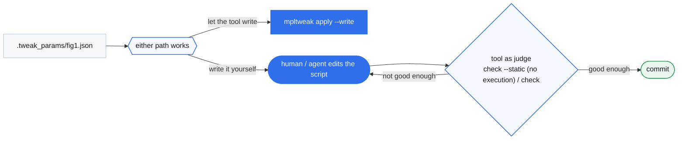

<div align="center">


# mpltweak

**Lay out matplotlib figures the way you arrange slides in PowerPoint, then write the numbers back into your code.**

[](https://pypi.org/project/mpltweak/)
[](https://pypi.org/project/mpltweak/)
[](LICENSE)
[](https://github.com/shdbl/mpltweak/actions/workflows/tests.yml)

[中文](https://github.com/shdbl/mpltweak/blob/main/README.md) | **English**

Docs linked from this file (`docs/*.md`) are currently written in Chinese.

</div>

## Contents
- [What problem it solves](#what-problem-it-solves)
- [Demo](#demo)
- [Key map](#key-map)
- [Install + quick start](#install--quick-start)
- [Edit numbers in place, or insert a layout block](#edit-numbers-in-place-or-insert-a-layout-block)
- [Using it as a skill (for AI clients)](#using-it-as-a-skill-for-ai-clients)
- [Layout interface for AI / agents](#layout-interface-for-ai--agents)
- [How humans and agents split the work](#how-humans-and-agents-split-the-work)
- [Workflow](#workflow)
- [Three verification layers](#three-verification-layers)
- [Execution boundaries: which commands run your script](#execution-boundaries-which-commands-run-your-script)
- [When it does not apply (up front)](#when-it-does-not-apply-up-front)
- [Static study on real plotting code](#static-study-on-real-plotting-code)
- [Params file](#params-file)
- [Development](#development)
- [License](#license)

## What problem it solves

When you lay out a multi-panel figure, the trouble is usually the layout rather than the data: move one subplot and the neighbouring axis label is covered; increase a font size a little and the legend overlaps a curve. And every change means re-running the script and looking at the figure again.

**What mpltweak does**: you drag panels the way you arrange pictures in PowerPoint, and then those few numbers go back into your source code.

| Approach | Flow |
|---|---|
| **Traditional** | change a number → re-run the script → wait tens of seconds → look at the PNG → still wrong → change again |
| **mpltweak** | open the window → drag into place → `mpltweak apply --write` → those numbers are back in the code |

**Writing back is deterministic.** AST-based location; write-back takes one of two forms: **when the code holds literals, those numbers are edited directly** (no insertion of any kind); **otherwise a self-contained layout block is inserted** (no added import, no change to your own logic). Both forms go through three verification layers (syntax / re-run / semantic); if any layer does not pass, the file is **rolled back to the pre-batch state**, with the backup left in `.tweak_params/<script>.tweak.bak`.

**Changing source code requires determinism**; that is the premise mpltweak is built on.

**It only handles style and position; it does not invent content**: text, data and graphics are still decided by your code.

## Demo

<table>
<tr>
<td width="50%"><br>
<b>Drag + edge snapping</b><br><sub>A ghost preview and alignment guides appear while dragging; near an alignment position it snaps</sub></td>
<td width="50%"><br>
<b>Multi-select align / distribute</b><br><sub>Ctrl-click three panels → left align + vertical distribute</sub></td>
</tr>
<tr>
<td><br>
<b>Font size on hover</b><br><sub>Hover a title, axis label, tick label or legend and press <code>+</code> / <code>-</code></sub></td>
<td><br>
<b>Wireframe mode for speed (space bar)</b><br><sub>Full redraw of a cartopy world map <b>494ms → 169ms</b>, so dragging keeps up</sub></td>
</tr>
</table>

**Gestures (similar to PowerPoint):** drag panels, Ctrl multi-select, align / distribute (Ctrl+Shift+L/R/T/B/C/M, H/V), edge snapping (with guides), Ctrl+F fit canvas and trim margins, space bar for wireframe mode, hover to change font size, legend snapping to 8 standard positions, colorbar length / thickness.

## Key map

| Action | Effect |
|---|---|
| **`?`** | **open / close the key help overlay** (Esc closes it, L toggles Chinese/English) |
| Drag a panel / drag an edge or corner | move / PowerPoint-style resize (opposite edge fixed; aspect-locked axes keep their ratio) |
| **Ctrl+click** (or Shift+click) | add to / remove from the selection; drag on empty space for a rubber-band selection |
| **Ctrl+Shift+L/R/T/B/C/M** | align: left / right / top / bottom / horizontal centre / vertical centre |
| **Ctrl+Shift+H / V** | distribute: horizontal / vertical (ends fixed, equal gaps between) |
| **Ctrl+Z** / **Ctrl+Y** (or Ctrl+Shift+Z) | undo / redo |
| Hover text, then `+` / `-` | font size of title, axis label, tick labels, legend, colorbar |
| **Space** | wireframe mode (borders and text only, data artists hidden) |
| **Ctrl+F** | fit canvas to content (trims margins; subplot pixel size unchanged) |
| **Arrow keys** / Shift+arrow | move a panel (PowerPoint habit) / nudge size (centre fixed) |
| Drag a colorbar long-axis end / thin edge / middle | length / thickness / translate the whole bar |
| Drag a legend | preview of 8 standard positions + snap on release |
| `[` `]` · `c` · `C` · `g` · `s` · `x` `y` | line width / line colour / colormap / grid / spines / linear-log axes |
| `n` · `e` | snapping toggle / manual export |
| Drag the window edge | change canvas size (writes back `figsize`) |

## Install + quick start

```bash
pip install mpltweak            # core: describe / check / apply (mcp is an optional adapter layer, see "layout interface for AI / agents")
pip install "mpltweak[qt]"      # add this if you want to **drag figures in a window** (installs the PyQt5 backend)
```

Opening a window needs a graphics backend (PyQt5 recommended, about +150MB), hence the two steps: server / headless / agent-only use cases only need `describe` / `check` / `apply` and should not install a whole Qt stack for it (some environments already ship PySide6 / PyQt6). The official Python installers for Windows / macOS bundle `tkinter`, so `pip install mpltweak` alone usually opens a window; in that case it uses the **Tk backend (reduced interaction)**, which is neither an installation failure nor a broken install. With no backend at all, opening the window exits with `rc=4` and prints which one to install. Backend comparison, probing order and common problems: [docs/interaction.md](https://github.com/shdbl/mpltweak/blob/main/docs/interaction.md); command execution boundaries: [docs/exec-boundaries.md](https://github.com/shdbl/mpltweak/blob/main/docs/exec-boundaries.md).

### Window backend: Qt (recommended) or Tk (default)

`mpltweak[qt]` gives Qt (richest interaction); with only the core package you get Tk (reduced: it opens a window, but some gestures are missing); with neither backend, opening a window exits with `rc=4` and prints which one to install.
Backend comparison table, per-platform installs and probing order: [docs/interaction.md](https://github.com/shdbl/mpltweak/blob/main/docs/interaction.md).

### 1 · Your existing script, unchanged

```python
# fig1.py -- ordinary matplotlib, nothing added
import matplotlib.pyplot as plt
import numpy as np

fig = plt.figure(figsize=(10, 8))
x = np.linspace(0, 1, 200)

ax1 = fig.add_axes([0.08, 0.66, 0.30, 0.21])      # the position is these numbers
ax1.plot(x, np.sin(6 * x))
ax1.set_title('(a)')

ax2 = fig.add_axes([0.11, 0.38, 0.30, 0.21])      # hand-written numbers, usually uneven
ax2.scatter(np.random.rand(60), np.random.rand(60), s=8)

ax3 = fig.add_axes([0.05, 0.08, 0.30, 0.21])
ax3.hist(np.random.randn(300), bins=20)

fig.savefig('fig1.png', dpi=150)
```

No `import mpltweak`, no hooks.

### 2 · Open the layout window

```bash
mpltweak fig1.py
```

> Subcommands: `launch` / `apply` / `revert` / `describe` / `check` / `schema` / `mcp` / `doctor`.
> `mpltweak fig1.py` and `mpltweak launch fig1.py` are equivalent; apart from that, the first argument is always interpreted as a **script path**.

In the window: **drag** panels to move them, drag **edges / corners** to resize, **Ctrl-click** to select several panels → `Ctrl+Shift+L` left align / `Ctrl+Shift+V` vertical distribute, **hover text** and press `+` `-` to change font size, **space** for wireframe (faster on heavy figures), **Ctrl+F** to trim margins. Press **`?`** at any time for the key help page; the key table and workflow diagram are in [docs/interaction.md](https://github.com/shdbl/mpltweak/blob/main/docs/interaction.md).

**Close the window when you are done.** The script has not changed by a single character at this point; the params land in `.tweak_params/fig1.json`.

### 3 · See what it intends to change (read-only)

```bash
mpltweak apply fig1.py
```

It prints the position and font-size inventory of every axis, and writes no file.

### 4 · Write back

```bash
mpltweak apply fig1.py --write
```

```text
✓ written back in place: fig1.py
  4 in-place edits: ax0.pos, ax1.pos, ax2.pos, ax3.pos
  backup: .tweak_params/fig1.tweak.bak
  ✓ Agg re-run verification passed
  ✓ semantic verification passed (target figure state == params)
```

The block above is the output of **one real write-back**; "re-run / semantic verification" re-runs the script **in your environment** (if it cannot run, or the semantics do not match, the file is rolled back; see "Three verification layers").

When the code holds literals it edits only the numbers inside `add_axes([...]`; otherwise it inserts a self-contained layout block. If any verification step fails, the file is rolled back.

### 5 · Re-run and look

```bash
python fig1.py
```

### If nothing happens

No window, no change after write-back, or wondering where the params come from: see "If nothing happens" in [docs/interaction.md](https://github.com/shdbl/mpltweak/blob/main/docs/interaction.md) (a per-symptom table covering `doctor`, `--timeout 600`, `--force-resume`, layout-engine conflicts and more).

## Edit numbers in place, or insert a layout block

Take `fig1.py`. **Before** (hand-written numbers, usually uneven):

```python
ax1 = fig.add_axes([0.08, 0.66, 0.30, 0.21])
ax2 = fig.add_axes([0.11, 0.38, 0.30, 0.21])
ax3 = fig.add_axes([0.05, 0.08, 0.30, 0.21])
```

**After you drag** (the result of `mpltweak apply --write`):

```diff
-ax1 = fig.add_axes([0.08, 0.66, 0.30, 0.21])
+ax1 = fig.add_axes([0.08, 0.655, 0.300, 0.215])
-ax2 = fig.add_axes([0.11, 0.38, 0.30, 0.21])
+ax2 = fig.add_axes([0.08, 0.380, 0.300, 0.215])
-ax3 = fig.add_axes([0.05, 0.08, 0.30, 0.21])
+ax3 = fig.add_axes([0.08, 0.085, 0.300, 0.215])
```

The code holds literals, so **only those numbers moved**: no line added, no `import`, no dependency. The same holds for font sizes, legend position, grid and colorbar: what changes is parameters your code already had.

When the position comes from `plt.subplots()` / `plt.subplot(1,2,n)` / `GridSpec`, there is no number in the source to edit. Such a figure gets a **self-contained layout block** inserted:

```python
# ===== auto layout (generated) - do not edit inside =====
# generated by mpltweak on 2026-10-10 16:45 (you may tweak it; keep the two marker lines)
# axis identity (while laying out): ax0=grid[2, 2, 0, 0], ax1=grid[2, 2, 0, 1], ...
for _ax, _p in zip(fig.axes, [
    [0.0728, 0.5363, 0.4418, 0.4015],
    [0.5394, 0.5363, 0.4418, 0.4015],
]):  # ... one position per axis of the 2x2 grid
    _ax.set_position(_p)
fig.axes[0].title.set_fontsize(12)
fig.axes[0].grid(False)
# ===== end auto layout =====
```

Those two marker lines are **written into your script**; `grep auto layout` finds the block. The block is **self-contained**: no added `import`, nothing beyond matplotlib, no change to your logic; a repeated write-back **replaces it as a whole**. To force one path only: `--style inplace` (no block is inserted; a field that cannot be written in place fails with `rc=1`) or `--style block` (always inserts a block).

The per-field three-state rule (① already written in place ② equal to the current source value ③ has a target value, differs from the current one, cannot be written in place), and the boundaries of "zero intrusion" (`describe → apply` straight through pins the whole state into the source; give less to change less) are in [docs/params.md](https://github.com/shdbl/mpltweak/blob/main/docs/params.md). The hard constraints on the insertion point (only before the last `savefig` / `show`; `anchor` / `attempts` as measured), a write-back rejected as a whole, and mixing both forms across rounds are in [docs/verify.md](https://github.com/shdbl/mpltweak/blob/main/docs/verify.md).

### `--style` and JSON fields: did this run land?

`--style` has two paths. `auto` (default) edits in place where it can and falls back to inserting a layout block where it cannot; `inplace` (explicit) requires in-place edits, and fails with `rc=1` / `applied=false` where it cannot instead of reporting success; `block` always inserts a block.
Whether things landed is read from `files[]` of `apply --json`: `needs_block`, `pending`, `inplace_pending` / `inplace_needs_block`, `auto_fallback`, `inplace_changes` / `inplace_reason`.
Per-field meanings and the measured comparison of the three styles (rc / JSON): [docs/params.md](https://github.com/shdbl/mpltweak/blob/main/docs/params.md).

## Using it as a skill (for AI clients)

[`skills/mpltweak/SKILL.md`](https://github.com/shdbl/mpltweak/blob/main/skills/mpltweak/SKILL.md) in this repository is an operating manual written for AI (Agent Skills format): the commands, the rules, and the human-machine workflow. Drop it into your client's skills directory (for example `~/.dsh/skills/`), or paste its content to the AI.

**How the two sides fit together**: the AI decides what the figure should look like (reading the output of `describe`, editing the params file), and mpltweak decides **whether the change actually landed** (three verification layers + rollback on error + `revert`) — it does not rely on the AI saying "I fixed it". mpltweak itself contains no AI model; it provides commands and a verdict. The `--json` output carries `ok` / `reason` / `changes` / `pending` for the AI to read.

MCP (the optional adapter layer) and the JSON contract: [docs/agent.md](https://github.com/shdbl/mpltweak/blob/main/docs/agent.md).

## Layout interface for AI / agents

Large models write correct plotting code, but **layout numbers are mostly guesswork** for them. mpltweak turns that part from guessing into writing a file: the **params file is a public JSON format (with a JSON Schema)**, so an agent can generate or edit it directly and `mpltweak apply --write` applies it.

```bash
mpltweak describe fig1.py -o layout.json   # read: export the current layout (--all-figs exports several figures at once)
mpltweak apply fig1.py --write --json      # write: apply into the source (with --json all progress output goes to stderr)
mpltweak check fig1.py --json              # check: layout health check; the exit code is the CI gate
```

`--json` is for machines: the `style` / `applied` / `changes` / `needs_block` / `pending` fields inside `files[]` tell whether this run landed; the `schema` subcommand prints the JSON Schema of the params file so an agent can validate what it generated.

The table of the four subcommands, exit-code semantics, the read → modify → write → check loop, and the parameter signatures of the four MCP tools: [docs/agent.md](https://github.com/shdbl/mpltweak/blob/main/docs/agent.md).

### Also available as an MCP server (optional adapter layer)

**A client that can run shell commands does not need MCP**; MCP targets clients that cannot run shell commands (Claude Desktop and similar). Optional dependency (Python ≥ 3.10): `pip install "mpltweak[mcp]"`, then `mpltweak mcp` starts the stdio server; add to the client config: `{"mcpServers": {"mpltweak": {"command": "mpltweak", "args": ["mcp"]}}}`.
It exposes a subset of the CLI: `describe_layout` / `check_layout` / `params_schema` / `apply_layout` (`write=False`); `revert`, `--style`, `--verify-fast`, `--strict` and others exist only in the CLI. The actual parameter signatures of the four tools and the best-effort maintenance policy: [docs/agent.md](https://github.com/shdbl/mpltweak/blob/main/docs/agent.md).

## How humans and agents split the work

Two common splits: **human drags → agent applies** (you finish dragging in the window and say "apply it"; the AI runs `apply --write`); **agent drafts → human fine-tunes** (the AI lays out a first version → you keep adjusting in the window, the params continue from there → you confirm the write-back).

The rule: **an agent can decide which numbers to change; whether the change is correct is decided by the product** (`check` and the three verification layers return the verdict, and a failing run is rolled back).

The other three collaboration modes (agent self-check / one figure as a template / human drags then agent summarises): [docs/agent.md](https://github.com/shdbl/mpltweak/blob/main/docs/agent.md).



## Workflow

```mermaid
flowchart TD
    A["fig1.py<br/>plain matplotlib, no edits needed"]:::script
    B(["interactive window<br/>drag · align · snap · font size"]):::win
    C[".tweak_params/fig1.json<br/>params written quietly, code untouched"]:::script
    P["read-only preview:<br/>which numbers in place / block or not / refuse or not"]:::check
    D{"per-field decision"}:::check
    D0(["【equal】no_change<br/>not one byte touched"]):::ok
    D1["【in place】replace those numbers<br/>everything else byte-identical"]:::script
    D2{"is the insertion point legal?<br/>(before the last savefig / show)"}:::check
    D2b{"can the target object in the block<br/>be proven statically?<br/>(variable name, not fig.axes[i])"}:::check
    D3["【append】insert a self-contained layout block"]:::script
    D4["【refuse】not one byte touched<br/>state the reason + print a paste-ready snippet"]:::bad
    PASTE(["you paste those lines by hand<br/>(replacing placeholders with your variable names)"]):::win
    E{"verification<br/>default: syntax + re-run + semantic<br/>--verify-fast: ast.parse only"}:::check
    F(["commit the change + keep a backup"]):::ok
    G(["roll back to the pre-batch state"]):::bad
    R(["revert: back to the file before the write-back"]):::ok

    A -->|mpltweak fig1.py| B
    B -->|close the window| C
    C -->|apply (without --write)| P
    P -->|after you confirm: apply --write| D
    D -->|target value == current source value| D0
    D -->|literals exist| D1
    D -->|none| D2
    D2 -->|illegal| D4
    D2 -->|legal| D2b
    D2b -->|provable| D3
    D2b -->|not provable| D4
    D1 --> E
    D3 --> E
    E -->|pass| F
    E -->|fail| G
    D4 --> PASTE
    PASTE -.->|run the read-only preview again later| P
    F -.->|second thoughts| R

    classDef script fill:#F7F8FA,stroke:#C9D1DB,stroke-width:1.4px,color:#16181D
    classDef win fill:#2F6FEB,stroke:#2F6FEB,stroke-width:1.6px,color:#FFFFFF
    classDef check fill:#F5F8FF,stroke:#2F6FEB,stroke-width:1.6px,color:#16181D
    classDef ok fill:#EAF7EF,stroke:#2E9E5B,stroke-width:1.4px,color:#16181D
    classDef bad fill:#FEF3E2,stroke:#D97706,stroke-width:1.4px,color:#16181D
```

From opening the window through `mpltweak apply --write`, the script does not change by a single character at any intermediate step (including after the window is closed); the write-back is the action you explicitly approve in step three.

## Three verification layers

1. **Syntax layer** (`layers.syntax`): after writing to disk, an unconditional `ast.parse` on both paths (in-place and block); a syntax error rolls back to the pre-batch state on the spot.
2. **Re-run layer** (`layers.rerun`): a headless Agg re-run; a non-zero exit code is then classified as "the script could not run in the first place" versus "the write-back broke it".
3. **Semantic layer** (`layers.semantic`): after the re-run it dumps the target figure state and compares it field by field against the params (position / font sizes / `grid` / `spines` / `clim` and others); when a field cannot be judged, `verified=null` and `detail` lists the fields that were not judged.

If any layer does not pass, the file is rolled back to the pre-batch state; the pre-write original is backed up in `.tweak_params/<script>.tweak.bak`. Per-layer details and how they relate to `--verify-fast` / `--keep-unverified`: [docs/verify.md](https://github.com/shdbl/mpltweak/blob/main/docs/verify.md).

### Speed and gates: `--verify-fast` and `--strict`

**`--verify-fast` (speed)**: only the `ast.parse` after writing, so it is fast; it does not show that the script runs, nor that the layout landed on the target figure (JSON reports `verify_mode: "fast"`).
**`--strict` (gate)**: `check --strict` upgrades layout-engine conflicts (`constrained_layout` / `autolayout`) from a note to a problem (`rc=1`); `apply --write --strict` refuses to write back when a conflict exists (add `--allow-layout-conflict` to let it through). The `ok` field plus exit code of `check --json` works as a CI case directly; `check` accepts one script at a time, so batching needs a loop of your own.
Other details (the boundary of `--no-verify`, the `bbox_inches='tight'` downgrade, `--tol` accepting finite positive numbers only, the `--static` gate, a batch script example): [docs/verify.md](https://github.com/shdbl/mpltweak/blob/main/docs/verify.md).

### Second thoughts: `mpltweak revert`

Wrong write-back, or you liked the earlier version better? No need to dig through backups:

```bash
mpltweak revert fig1.py            # preview only: which lines would change back (default, code untouched)
mpltweak revert fig1.py --write    # actually go back to "before the last write-back"
```

It uses the backup **next to the params file** (by default `.tweak_params/<script>.tweak.bak`, written automatically before every `apply --write`). If the write-back used `--params`, the revert needs the same `--params`, otherwise it reports `[revert] no backup to revert to` (`rc=2`).
It reverts the **most recent** write-back: the backup is overwritten on each write-back, so after several write-backs a revert no longer reaches the earliest original.
**The revert itself is reversible**: before overwriting, the current version is saved as `<script>.revert.bak` (also next to the params file), so an accidental revert can be undone.
Restoring is a **byte-for-byte copy** (BOM / line endings / encoding untouched).

## Execution boundaries: which commands run your script

`describe` / `check` / opening the window **execute** your script (in a **subprocess**, headless Agg; the exit code and any global state stay inside that subprocess). `apply` only rewrites the AST, unless you ask for **re-run verification** (after `--write` it re-runs once by default; `--verify-fast` only does `ast.parse`).

Exit-code semantics, the effect of a script calling `sys.exit()` itself, and the CI usage of `--strict`: [docs/exec-boundaries.md](https://github.com/shdbl/mpltweak/blob/main/docs/exec-boundaries.md).

## When it does not apply (up front)

Write-back verification re-runs the whole script **on your machine, in your environment**; that is part of the mechanism, not an optional step (`--no-verify` skips it, which amounts to switching off the safety net). So the following scripts are out of scope:

| Script property | Why |
|---|---|
| Takes a long time to run once (minutes or more) | every write-back re-runs it; `--timeout 600` only widens the wait, it does not remove it |
| Reads large data / needs a heavy environment / needs network or credentials | a headless re-run stalls or fails |
| Needs human input midway (`input()`, interactive choices) | a headless re-run blocks |
| A figure that is only meaningful under a specific interactive backend | verification always uses the headless Agg backend |

Such scripts take the read-only route (`mpltweak describe` / `mpltweak check`, neither writes back), or you edit the code by hand.
Its target users are **small and medium research plotting scripts that run locally**.

## Static study on real plotting code

<div align="center">

</div>


This section reports a **static study run on real plotting code**. The corpus is **10,158 sha256-unique** public plotting scripts from real projects: **6904 records in Zenodo datasets**, **2045 scripts from research plotting repositories on GitHub**, and **1209 files from official project galleries**; many of them are **supplementary material of published papers**.
The study only does **static** location and rewrite decisions (**it does not execute** the corpus scripts and does **not redistribute** them). The per-script URL / licence / sha256 are in [`bench/manifest.jsonl`](https://github.com/shdbl/mpltweak/blob/bench/bench/manifest.jsonl); the harness and the per-script conclusions are in the [`bench` branch](https://github.com/shdbl/mpltweak/tree/bench) (the verdict files are sanitised: judgement fields only, no script text). Of these, **4,427** are plotting scripts (2,396 statically analysable / 1,940 with no figure / 90 with syntax errors / 1 still timing out under isolated re-scan). The denominators in the tables below come from the **measurable sites** in those scripts.

### Where the corpus comes from (reproducible)

| Source | Count (measured in `manifest.jsonl`) |
|---|---:|
| Zenodo dataset records (`.py` files in paper supplementary material) | **6,904** |
| GitHub research-plotting repositories (61 repo names) | **2,045** |
| Official / project galleries | **1,209** |
| **Total** | **10,158** |

Selection and de-duplication: **`.py` files only, made unique by sha256** (a script that appears in
several places is kept once) — the merge stage saw **10,168** raw files and kept **10,158** after
sha256-uniquing (10 byte-identical duplicates dropped; local build log `corpus_union/_logs/build_summary.json`, not published with the repo:
`copied=10168 / unique_sha=10158`, `sha_mismatch=0 / size_mismatch=0 / undecodable=0`). An earlier
cross-stage merge additionally skipped **`dup_cross_stage = 1469`** records whose sha256 was already
seen (the same script caught by both the GitHub and the Zenodo stage). **The corpus itself is kept
locally, read-only, and is not redistributed** — only the manifest (path / source / URL / licence /
sha256 / size) and the **sanitised per-script verdicts** are published. To check how a given script was
judged, fetch it yourself with the `sha256` / `url` from the manifest. Everything lives in the
[`bench` branch](https://github.com/shdbl/mpltweak/tree/bench): `manifest.jsonl`, `verdicts/*.jsonl` (per-script verdicts),
`harness/` (scaffolding) and `tools/` (the two table generators plus the sanitisation self-check).

### 1. In-place edits (numbers edited directly in the source)

| Item | Scripts with a site for this family | Scripts reachable in place | In-place write-backs (combinations) | Pass rate |
|---|---:|---:|---:|---:|
| Canvas size `figsize` | 2,256 | 2,256 | 2,247 | **99.6%** |
| Panel position `pos` | 131 | 94 | 93 | 98.9% |
| Title font size | 193 | 173 | 165 | 95.4% |
| Axis label font size x | 181 | 173 | 160 | 92.5% |
| Axis label font size y | 180 | 171 | 166 | 97.1% |
| Tick font size x | 189 | 91 | 85 | 93.4% |
| Tick font size y | 6 | 5 | 4 | not enough samples (n=5) |
| Grid `grid` | 131 | 124 | 118 | 95.2% |
| Axis range `xlim` | 401 | 247 | 232 | 93.9% |
| Axis range `ylim` | 433 | 276 | 261 | 94.6% |
| **Total** | **4,101** | **3,610** | **3,531** | **97.8%** |

- **Pass rate = in-place write-backs ÷ reachable in place** (not ÷ "the source contains this item").
- **The totals are sums over families**; different families of the same script are counted once each, so they **are not script counts**.
- **Broken promises = 0**: no row reports "the tool claims an in-place write-back while the bytes did not change" (within the scope of this static corpus judgement).
- The cases that did not go in place fall into three groups, with per-script lists in the [`bench` branch](https://github.com/shdbl/mpltweak/tree/bench): **invalid params refused 37** · **refused because the target object could not be proven 7** · **done by inserting a block 3** (none of them silently drops a change).

### 2. Appended code blocks (items that cannot be expressed in place)

| Item | Blocks | Original text preserved byte for byte | No runtime indexing inside the block | Target value landed |
|---|---:|---|---|---|
| Whole corpus this round | 427 | ✓ | 427 / 427 | ✓ |

- Criteria for the block path: original text preserved byte for byte (line endings included) · the block does not use **runtime** locators such as `fig.axes[i]` / `plt.gca()` · it acts on the target object · idempotent · can be `revert`ed.
- `spines` / `xscale` / `yscale` / `clim` can only go through the block path and **were not part of the in-place judgement this round** (the scan covered the ten in-place families only), so they are **not counted in the table above**.

### 3. What the part below 100% consists of

| Family | In place | Landed by block | Refused, not provable | Invalid params refused |
|---|---:|---:|---:|---:|
| `figsize` | 2,247 | 0 | 0 | 0 |
| `pos` | 93 | 0 | 0 | 0 |
| Title font size | 165 | 1 | 0 | 1 |
| Axis label font size x | 160 | 0 | 1 | 11 |
| Axis label font size y | 166 | 0 | 1 | 0 |
| Tick font size x | 85 | 2 | 3 | 1 |
| Tick font size y | 4 | 0 | 1 | 0 |
| `grid` | 118 | 0 | 1 | 3 |
| `xlim` | 232 | 0 | 0 | 9 |
| `ylim` | 261 | 0 | 0 | 12 |
| **Total** | **3,531** | **3** | **7** | **37** |

- **Landed by block (3 cases) is not a failure**: the change landed, it just took the appended-block path.
- **Refused, not provable (7 cases) is deliberate**: when it cannot statically decide "which figure / which axis is being changed", it **does not write** (`applied=false`, non-empty `pending`) and prints a paste-ready snippet for a manual edit.
- **Invalid params refused (37 cases)**: the params derived by the measurement harness from sites crossed the validator's legal boundaries (for example an out-of-range axis index, or duplicate axis names within one figure); refusing them is correct behaviour. **If those 37 are removed from the denominator, the pass rate of axis label x is 160/161 ≈ 99.4%**; that removal must state its own denominator, so both numbers are listed.

> Judgement scope: everything is **static** (AST location and rewrite decisions only; corpus scripts are not executed). Summary: **97.8% of the changes land in place in the source (3,531 / 3,610), and no run claims a change it did not make.**

## Params file

The params file is a **public format**: you can edit it by hand, or let an AI / agent generate it, and `--write` applies it either way. The top-level `version` marks the format version (currently 4):

```jsonc
{ "version": 4, "script": "fig1.py",
  "axes": [ { "index": 0, "pos": [0.048, 0.655, 0.30, 0.215], "title_fontsize": 9.0 } ] }
```

**Only fields given explicitly are written**: a field absent from the params is not written back. The field table (`figsize_px` / `figsize_in` / `aspect_locked` / `cell` / `clim` / `cmap` / `lines` / `legend` / `tick_fontsize_y` ...) and the two conventions (`axes[i]` order, colorbar slot axes not taking an index): [docs/params.md](https://github.com/shdbl/mpltweak/blob/main/docs/params.md).

## Development

Repository layout: `src/mpltweak/` (`cli.py` / `launch.py` / `toolbox.py` / `params.py` / `apply.py` / `writeback.py` / `verify.py`). Run the tests: `python tests/test_writeback.py` (AST write-back + three verification layers). The rest (installation, the full test command list, module responsibilities, the embedding API `from mpltweak.toolbox import gaitu`) is in [docs/dev.md](https://github.com/shdbl/mpltweak/blob/main/docs/dev.md).

## License

MIT
