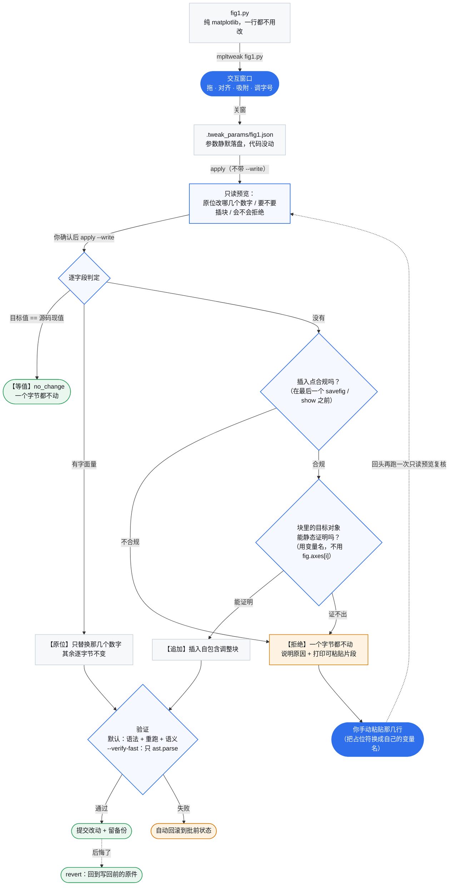

<div align="center">


# mpltweak

**像在 PPT 里调多图排版一样调 matplotlib，然后把参数写回你的代码。**

[](https://pypi.org/project/mpltweak/)
[](https://pypi.org/project/mpltweak/)
[](LICENSE)
[](https://github.com/shdbl/mpltweak/actions/workflows/tests.yml)

**中文** | [English](https://github.com/shdbl/mpltweak/blob/main/README.en.md)

</div>

## 目录

- [它解决什么问题](#它解决什么问题)
- [演示](#演示)
- [5 分钟上手](#5-分钟上手)
- [安装 + 快速开始](#安装--快速开始)
- [给 AI 和 agent 用](#给-ai-和-agent-用)
- [工作流](#工作流)
- [它可靠吗](#它可靠吗)

<details><summary><b>进阶与详细文档</b>（点击展开）</summary>

- [键位速查](#键位速查)
- [原位改数字，还是插入调整块](#原位改数字还是插入调整块)
- [三层验证](#三层验证)
- [执行边界：哪些命令会跑你的脚本](#执行边界哪些命令会跑你的脚本)
- [不适用场景（先说清楚）](#不适用场景先说清楚)
- [参数文件](#参数文件)
- [开发](#开发)
- [License](#license)

</details>
## 它解决什么问题

调一张多面板图（multi-panel figure）时，麻烦通常出在排版而不是数据：挪一下子图，旁边的轴标签就被挡住；字号放大一点，图例又压到曲线上。而每改一次，都要重跑脚本、再看一遍图。

**mpltweak 的做法**：像在 PPT 里摆放图片那样直接拖，拖完把那几个数字写回源码。

| 方式 | 流程 |
|---|---|
| **传统方式** | 改一个数字 → 重跑脚本 → 等几十秒 → 看 PNG → 还是不对 → 再改 |
| **mpltweak** | 打开窗口 → 拖到位 → `mpltweak apply --write` → 那几个数字回到代码里 |

**写回是确定性的。** AST 精确定位；写回分两种方式：**代码里写的是字面量时，直接改那几个数字**（最干净，不插入任何东西）；**否则插入一个自包含的调整块**（不加 import、不改动你原有的逻辑）。两种方式都过三层验证（语法 / 重跑 / 语义），任一层不过**默认**回滚到批前状态（`--keep-unverified` 可保留，需自己验证），备份留在 `.tweak_params/<脚本名>.tweak.bak`。

**要动源码，就必须做到确定性** —— 这是 mpltweak 的设计前提。

**它只管样式和位置，不发明内容** —— 文字、数据、图形仍完全由你的代码决定。

> 如果你是用 AI 写图的（让 agent 来读排版 / 出计划 / 写回），直接看 [给 AI 和 agent 用](#给-ai-和-agent-用)。

## 演示

<table>
<tr>
<td width="50%"><br>
<b>拖动 + 边缘吸附</b><br><sub>拖动时给出 ghost 预览与对齐参考线，靠近对齐位置自动贴合</sub></td>
<td width="50%"><br>
<b>多选对齐 / 均分</b><br><sub>Ctrl 加选三个面板 → 左对齐 + 垂直均分</sub></td>
</tr>
<tr>
<td><br>
<b>悬停改字号</b><br><sub>鼠标悬停标题、轴标签、刻度或图例，按 <code>+</code> / <code>-</code> 直接调</sub></td>
<td><br>
<b>线框模式提速（空格）</b><br><sub>cartopy 全球图全量重绘 <b>494ms → 169ms</b>，拖动不再卡顿</sub></td>
</tr>
</table>

**操作手势（与 PPT 类似）：** 拖动面板、Ctrl 多选、对齐 / 均分（Ctrl+Shift+L/R/T/B/C/M、H/V）、边缘吸附（带参考线）、Ctrl+F 适配画布裁白边、空格切线框模式、悬停改字号、图例吸附 8 个标准位、colorbar 调长度 / 厚度。

## 5 分钟上手

第一次用**不用读完这份 README**，照着下面走一遍就能看到效果。示例脚本 `fig1.py` 就是后面「安装 + 快速开始」第 1 步那段代码 —— **先把它存成 `fig1.py`**，然后：

| 步 | 命令 | 你会看到 |
|---|---|---|
| **1 · 装** | `pip install mpltweak`<br>`pip install "mpltweak[qt]"` | 核心包 + 开窗要的图形后端；只跑命令行（`describe` / `check` / `apply`）不用装第二条 |
| **2 · 开窗拖** | `mpltweak fig1.py` | 调图窗口：**拖**面板移动、拖**边 / 角**缩放、鼠标**悬停文字**按 `+` `-` 调字号、**空格**切线框提速、**Ctrl+F** 裁白边；按 **`?`** 出全部键位 |
| **3 · 关窗** | —— | 脚本**一个字符都没变**；参数落在 `.tweak_params/fig1.json`（没调好就再开窗接着调） |
| **4 · 看它打算改什么** | `mpltweak apply fig1.py` | 逐轴列出位置与字号，并说明**改哪个数字 / 要不要插调整块 / 会不会拒绝**；只读，不执行脚本、不写文件 |
| **5 · 写回** | `mpltweak apply fig1.py --write` | 只改那几个数字（**只改数字**那一类的真实样张见「安装 + 快速开始」第 4 步；细节见下面一段） |
| **6 · 重跑看图** | `python fig1.py` | 图就是你拖完的样子；不满意：`mpltweak revert fig1.py --write` 退回写回前（先不带 `--write` 是预览） |

**一次真实写回**的输出样张在下面「安装 + 快速开始」的第 4 步 —— 那是"只改数字"那一种：你实际看到几个轴、几处改动取决于你的脚本；如果脚本里还有源码没写到的字段（比如线宽 / 颜色），它会在文件末尾再追加一段自包含调整块，输出里会说明，并给出备份路径。

## 键位速查

| 操作 | 作用 |
|---|---|
| **`?`** | **打开 / 关闭键位帮助页**（画布内浮层：Esc 关闭，L 切换中英文） |
| 拖面板 / 拖边框、角 | 移动 / PPT 式缩放（对边固定；锁长宽比的轴自动等比） |
| **Ctrl+点击**（或 Shift+点击） | 多选加选 / 减选；拖空白处橡皮筋框选 |
| **Ctrl+Shift+L/R/T/B/C/M** | 对齐：左 / 右 / 上 / 下 / 水平居中 / 垂直居中 |
| **Ctrl+Shift+H / V** | 均分：水平 / 垂直（两端不动，中间等间距） |
| **Ctrl+Z** / **Ctrl+Y**（或 Ctrl+Shift+Z） | 撤销 / 重做 |
| 悬停文字后 `+` / `-` | 标题、轴标签、刻度、图例、colorbar 的字号 |
| **空格** | 线条模式（只留边框与文字，隐藏数据图元） |
| **Ctrl+F** | 适配画布到内容（裁掉四周白边，子图像素不变） |
| **方向键** / Shift+方向键 | 移动面板（PPT 习惯）/ 微调尺寸（中心不动） |
| 拖 colorbar 长轴端点 / 细条边 / 中点 | 调长度 / 调厚度 / 整条平移 |
| 拖图例 | 8 个标准位预览 + 松手吸附 |
| `[` `]` · `c` · `C` · `g` · `s` · `x` `y` | 线宽 / 线色 / colormap / 网格 / 边框 / 线性对数轴 |
| `n` · `e` | 吸附开关 / 手动导出 |
| 拖窗口边缘 | 改画布尺寸（写回 `figsize`） |

## 安装 + 快速开始

```bash
pip install mpltweak            # 核心：describe / check / apply（mcp 是可选适配层，见「给 agent 的通道」）
pip install "mpltweak[qt]"      # 要**开窗拖图**再加这个（装 PyQt5 图形后端）
```

开窗需要一个图形后端（推荐 PyQt5，约 +150MB），所以分成两步 —— 服务器 / headless / 纯 agent 场景只用 `describe` / `check` / `apply`，不该为此装一整套 Qt（有些环境本来也已经装了 PySide6 / PyQt6）。Windows / macOS 的官方 Python 安装包自带 `tkinter`，所以只装 `mpltweak` 一般就能直接开窗，此时用的是 **Tk 后端（交互弱化版）**，不是安装失败、也不是没装好；一个图形后端都没有时开窗 `rc=4` 并给出装哪个的提示。后端对照、探测顺序与常见问题见 [docs/interaction.md](https://github.com/shdbl/mpltweak/blob/main/docs/interaction.md)，命令执行边界见 [docs/exec-boundaries.md](https://github.com/shdbl/mpltweak/blob/main/docs/exec-boundaries.md)。

### 窗口后端：Qt（推荐）还是 Tk（默认可用）

装 `mpltweak[qt]` 走 Qt（交互最全）；只装核心包时用 Tk（弱化版，能开窗但手势不全）；两个后端都没有时开窗直接 `rc=4`，并提示该装哪一个。
后端对照表、各平台装法与探测顺序见 [docs/interaction.md](https://github.com/shdbl/mpltweak/blob/main/docs/interaction.md)。

### 1 · 你原来的脚本，一行都不用改

```python
# fig1.py —— 就是平时写的 matplotlib
import matplotlib.pyplot as plt
import numpy as np

fig = plt.figure(figsize=(10, 8))
x = np.linspace(0, 1, 200)

ax1 = fig.add_axes([0.08, 0.66, 0.30, 0.21])      # 位置就是这几个数字
ax1.plot(x, np.sin(6 * x))
ax1.set_title('(a)')

ax2 = fig.add_axes([0.11, 0.38, 0.30, 0.21])      # 手写的数字，通常都不齐
ax2.scatter(np.random.rand(60), np.random.rand(60), s=8)

ax3 = fig.add_axes([0.05, 0.08, 0.30, 0.21])
ax3.hist(np.random.randn(300), bins=20)

fig.savefig('fig1.png', dpi=150)
```

不需要 `import mpltweak`，不需要任何钩子。

### 2 · 打开调图窗口

```bash
mpltweak fig1.py
```

> 子命令：`launch` / `apply` / `revert` / `describe` / `check` / `schema` / `mcp` / `doctor`。
> `mpltweak fig1.py` 与 `mpltweak launch fig1.py` 等价；除此之外，第一个参数一律按**脚本路径**解释。

窗口里：**拖**面板移动、拖**边 / 角**缩放、**Ctrl 加选**多个面板 → `Ctrl+Shift+L` 左对齐 / `Ctrl+Shift+V` 垂直均分、鼠标**悬停文字**按 `+` `-` 调字号、**空格**切线框（大图提速）、**Ctrl+F** 裁掉白边。按 **`?`** 随时打开键位帮助页；键位表与工作流图见 [docs/interaction.md](https://github.com/shdbl/mpltweak/blob/main/docs/interaction.md)。

**调完直接关窗。** 此时脚本一个字符都没变，参数落在 `.tweak_params/fig1.json`。

### 3 · 先看它打算改什么（只读）

```bash
mpltweak apply fig1.py
```

打印每个轴的位置、字号清单，不写任何文件。

### 4 · 写回

```bash
mpltweak apply fig1.py --write
```

```text
  正在验证（子进程重跑脚本，最长 300s；不想等可加 --no-verify）
[OK] 已原位写回: fig1.py
  原位修改 3 处: ax0.pos, ax1.pos, ax2.pos
  备份: .tweak_params/fig1.tweak.bak
  [OK] Agg 重跑验证通过
  [OK] 语义验证通过（目标图状态 == 参数）
```

上面是**真实一次写回**的输出（路径省了目录前缀；你看到的会是绝对路径）；其中"重跑 / 语义验证"是在**你的环境**里重跑脚本得到的（跑不起来或语义不符都会回滚，见「三层验证」）。

**脚本自己带参数时**（依赖 `sys.argv`，如 `python fig1.py --data x.npz`）：把参数放在 `--` 后面，写回的重跑验证会原样透传给脚本，保证与基线一致、不误回滚：

```bash
mpltweak apply fig1.py --write -- --data x.npz --level 3
```

代码里写的是字面量时，它只改 `add_axes([...]` 里那几个数字；否则插入一个自包含的调整块。任何一步验证不过就自动回滚。

### 5 · 重跑看图

```bash
python fig1.py
```

### 如果没反应

没弹窗、写回后没变化、参数从哪来：先看 [docs/interaction.md](https://github.com/shdbl/mpltweak/blob/main/docs/interaction.md) 的「如果没反应」（含 `doctor`、`--timeout 600`、`--force-resume`、布局引擎冲突等逐条对照表）。

卡住了看 [docs/troubleshooting.md](https://github.com/shdbl/mpltweak/blob/main/docs/troubleshooting.md)（三个最常见的问题：拖了没反应 / 拖了弹回去 / 报错怎么办，每条都是「现象 → 一句话原因 → 怎么做」）。

## 原位改数字，还是插入调整块

以 `fig1.py` 为例。**动手前**（手写的数字，通常都不齐）：

```python
ax1 = fig.add_axes([0.08, 0.66, 0.30, 0.21])
ax2 = fig.add_axes([0.11, 0.38, 0.30, 0.21])
ax3 = fig.add_axes([0.05, 0.08, 0.30, 0.21])
```

**你拖完之后**（`mpltweak apply --write` 的结果）：

```diff
-ax1 = fig.add_axes([0.08, 0.66, 0.30, 0.21])
+ax1 = fig.add_axes([0.08, 0.655, 0.300, 0.215])
-ax2 = fig.add_axes([0.11, 0.38, 0.30, 0.21])
+ax2 = fig.add_axes([0.08, 0.380, 0.300, 0.215])
-ax3 = fig.add_axes([0.05, 0.08, 0.30, 0.21])
+ax3 = fig.add_axes([0.08, 0.085, 0.300, 0.215])
```

代码里写的就是字面量，所以**只动了这几个数字**：没有新增一行、没有加 `import`、没有引入任何依赖。字号、图例位置、网格、colorbar 同理，改的都是你代码里原本就有的参数。

位置来自 `plt.subplots()` / `plt.subplot(1,2,n)` / `GridSpec` 时，源码里没有数字可改。这种图改成**插入一个自包含的调整块**（下面是 2x2 网格的一次真实写回，头部两行与结尾标记行逐字照抄，中间重复的同类行用 `# …` 省略）：

```python
# ===== auto layout (generated) - do not edit inside =====
# 本块由 mpltweak 自动生成于 2026-10-12 19:42（可手动微调，勿删上下两行标记）
# 轴身份（调图时）：ax0=网格[2, 2, 0, 0]，ax1=网格[2, 2, 0, 1]，ax2=网格[2, 2, 1, 0]，ax3=网格[2, 2, 1, 1]
axes[0, 0].set_position([0.1450, 0.5500, 0.3723, 0.3700])
axes[0, 1].set_position([0.5677, 0.5500, 0.3723, 0.3700])
axes[1, 0].set_position([0.1450, 0.1300, 0.3723, 0.3700])
axes[1, 1].set_position([0.5677, 0.1300, 0.3723, 0.3700])
axes[0, 0].title.set_fontsize(14)
axes[0, 0].grid(True)
axes[0, 0].lines[0].set_linewidth(1.5)
axes[0, 0].lines[0].set_color('#1f77b4')
# … 其余三条轴各自同样几行（title / lines）
# ===== end auto layout =====
```

注意块里的写法：**逐轴一行、目标写成 `axes[0, 0]` 这种静态可证的表达式** —— 不是运行期下标（`fig.axes[i]` / `plt.gca()` 那类在运行期还可能指向 colorbar / inset 轴，工程上已不再使用）。开窗导出的是**整份状态**，所以连"当时恰好等于默认值"的字段也会被写死（上面 `lines[0]` 那两行就是），详见 [docs/verify.md](https://github.com/shdbl/mpltweak/blob/main/docs/verify.md)。

**能不能插块，取决于能不能静态证出目标对象**：`fig, axes = plt.subplots(2, 2)` 之后用 `axes[0, 0]` 这样的**字面量元素**定位可以落地（上图即实测）；把轴解包/放进循环里用（`for i, ax in enumerate(axes.ravel())`）或让建图形状不是字面量时，实测按 **fail-closed** 处理 —— **不写盘、`applied=false`**，只给一份可粘贴的手改片段（就是你手动落实的那条路，见 [docs/troubleshooting.md](https://github.com/shdbl/mpltweak/blob/main/docs/troubleshooting.md) ①）。

上下两行标记是**真写进你脚本的**，`grep auto layout` 就能定位。块是**自包含**的：不加 `import`、不依赖 matplotlib 之外的东西、不改你原有的逻辑；重复写回会**整体替换**它。想只走一条路：`--style inplace`（一处都不插块，写不了的字段 `rc=1` 明确失败）或 `--style block`（一律插块）。


## 给 AI 和 agent 用

仓库里的 [`skills/mpltweak/SKILL.md`](https://github.com/shdbl/mpltweak/blob/main/skills/mpltweak/SKILL.md) 是写给 AI 的操作手册（Agent Skills 格式）：
命令、使用铁律、人机协作方式。放进客户端的 skills 目录（如 `~/.dsh/skills/`），或直接把内容贴给 AI 即可。

**它是怎么配合的**：AI 决定这张图要改成什么样（读 `describe` 的输出、改参数文件），
mpltweak 负责判断"到底改对了没有"（三层验证 + 出错回滚 + `revert`）——**不靠 AI 自己说"我改好了"**。
所以 mpltweak 本身不含任何 AI 模型，它只提供命令和判断；`--json` 输出的
`ok` / `reason` / `changes` / `pending` 就是给 AI 读的结构化结果。


MCP（可选适配层）与 JSON 契约见 [docs/agent.md](https://github.com/shdbl/mpltweak/blob/main/docs/agent.md)。


大模型能写出正确的绘图代码，但**排版数字基本靠猜**。mpltweak 把这部分从"猜"变成"写文件"：**参数文件是公开 JSON 格式（带 JSON Schema）**，agent 直接生成或修改它，`mpltweak apply --write` 负责落实。

```bash
mpltweak describe fig1.py -o layout.json   # 读：拿到当前排版（--all-figs 一次导出多张图）
mpltweak apply fig1.py --write --json      # 写：落回源码（--json 时过程信息全走 stderr）
mpltweak check fig1.py --json              # 查：排版体检，退出码即 CI 门禁
```

`--json` 给机器读：`files[]` 里的 `style` / `applied` / `changes` / `needs_block` / `pending` 判读这次落没落地；`schema` 子命令输出参数文件的 JSON Schema，供 agent 校验自己生成的内容。

> **agent 读排版前先看布局引擎冲突**：`describe` 的产物带 `layout_engine` 字段（脚本里
> `constrained_layout` / `figure.autolayout` 的冲突点，带行号），MCP 的 `describe_layout` /
> `check_layout` 同样带。**非空就先 `mpltweak check <脚本> --static` 看一眼再动位置**——
> 这些引擎会在每次绘制时重算轴位置，你排好的布局会被它覆盖（表现为"验证不一致"）。
> 这是 0.1.9 实机调图会话踩出来的：人类开窗有终端提示，agent 通道却没有，白调一轮。

四个子命令的作用表、退出码口径、读 → 改 → 写 → 查回路、以及 MCP 四个工具的参数签名见 [docs/agent.md](https://github.com/shdbl/mpltweak/blob/main/docs/agent.md)。

### 也可以接进 AI 客户端（MCP）——**可选适配层**

**能跑 shell 的客户端不需要 MCP**；它面向拿不到 shell 的客户端（如 Claude Desktop）。可选依赖（Python ≥ 3.10）：`pip install "mpltweak[mcp]"`，然后 `mpltweak mcp` 起 stdio server；客户端配置加 `{"mcpServers": {"mpltweak": {"command": "mpltweak", "args": ["mcp"]}}}`。
它暴露 CLI 的子集：`describe_layout` / `check_layout` / `params_schema` / `apply_layout`（`write=False`）；`revert`、`--style`、`--verify-fast`、`--strict` 等只在 CLI 上。四个工具的实际参数签名与 best-effort 维护策略见 [docs/agent.md](https://github.com/shdbl/mpltweak/blob/main/docs/agent.md)。

### 人 + agent 怎么分工
两种常见分工：**人拖 → agent 落盘**（你开窗拖完说一句"落盘"，AI 跑 `apply --write`）；**agent 起草 → 人微调**（先按规则排一版 → 你开窗接着调，参数会续上 → 确认落盘）。

原则：**"改哪个数字"可以交给 agent，"改完对不对"由产品判定**（`check` 与三层验证给出结论，失败回滚）。

其余三种协作方式（agent 自检 / 一张图当模板 / 人拖完 agent 总结）见 [docs/agent.md](https://github.com/shdbl/mpltweak/blob/main/docs/agent.md)。


## 工作流



从打开窗口到 `mpltweak apply --write`，中间任何一步（包括关窗之后）脚本一个字符都不会变；
写回是你在第三步显式点头后的动作。

## 三层验证

1. **语法层**（`layers.syntax`）：写盘后无条件 `ast.parse`，原位与块两条路径都做；语法错误当场回滚到批前状态。
2. **重跑层**（`layers.rerun`）：用 Agg 无头重跑；退出码非 0 时区分"脚本本身跑不通"与"写回把它改坏了"。
3. **语义层**（`layers.semantic`）：重跑后 dump 目标图状态，与参数里的位置 / 字号 / `grid` / `spines` / `clim` 等逐字段比对；判定不了时 `verified=null`，`detail` 里列出未判定字段。

任一层不过即回滚到批前状态；写回前的原文备份在 `.tweak_params/<脚本>.tweak.bak`。逐层细节与 `--verify-fast` / `--keep-unverified` 的关系见 [docs/verify.md](https://github.com/shdbl/mpltweak/blob/main/docs/verify.md)。

### 加速与门禁：`--verify-fast` 与 `--strict`

**`--verify-fast`（加速）**：只做写盘后的 `ast.parse`，所以快；它不证明脚本能跑通、也不证明布局真的落到目标图上（JSON 里 `verify_mode: "fast"`）。
**`--strict`（门禁）**：`check --strict` 把布局引擎冲突（`constrained_layout` / `autolayout`）从提示升级为问题（`rc=1`）；`apply --write --strict` 遇到冲突拒绝写回（要放行加 `--allow-layout-conflict`）。`check --json` 的 `ok` 字段 + 退出码可直接当 CI 用例；`check` 一次只接受一个脚本，批量要自己循环。
其余细节（`--no-verify` 的边界、`bbox_inches='tight'` 的降级、`--tol` 只收有限正数、`--static` 静态门禁、批量脚本示例）见 [docs/verify.md](https://github.com/shdbl/mpltweak/blob/main/docs/verify.md)。

### 后悔了：`mpltweak revert`

写回错了、或者拖完发现还是原来那版好看？不用去翻备份：

```bash
mpltweak revert fig1.py            # 只预览：会改回哪几行（默认，不动代码）
mpltweak revert fig1.py --write    # 真的回退到"上次写回之前"
```

它用的就是**参数文件旁边**那份备份（默认 `.tweak_params/<脚本>.tweak.bak`，每次
`apply --write` 之前自动留的）。写回时若用了 `--params`，回退也要带上同一个 `--params`，
否则会报 `[revert] 还没有可回退的备份`（`rc=2`）。
回退的是**最近一次**写回 —— 备份每次写回都被覆盖，反复写回后再 revert 回不到最早的原文。
**revert 自身也可逆**：覆盖前会把当前版本另存为 `<脚本>.revert.bak`（也在参数文件旁边），
所以手滑了还能再回去。
恢复是**字节级原样复制**（BOM / 换行 / 编码都不动）。

## 执行边界：哪些命令会跑你的脚本

`describe` / `check` / 开窗会**执行**你的脚本（都在**子进程**里、Agg 无头；退出码与全局状态都留在子进程内）；`apply` 只做 AST 改写，除非你要求**重跑验证**（`--write` 后默认重跑一次，`--verify-fast` 只做 `ast.parse`）。

退出码语义、脚本自己 `sys.exit()` 的影响、`--strict` 的 CI 用法，见 [docs/exec-boundaries.md](https://github.com/shdbl/mpltweak/blob/main/docs/exec-boundaries.md)。

**写回前先做一次「可重跑预检」（0.1.10）**：默认要重跑验证时，`apply --write` 与开窗入口会**静态**看一眼
脚本（**不执行**），命中「缺依赖 / 需要参数 / 联网 / 等人输入 / 要弹窗」时给一段提示 + 一句可照抄的下一步
（`--json` 里是顶层 `preflight.risks[]`）。干净脚本一个字都不说；预检自己出岔子就放行，绝不影响写回与开窗。
五类判据与 JSON 字段见 [docs/exec-boundaries.md](https://github.com/shdbl/mpltweak/blob/main/docs/exec-boundaries.md)。

## 不适用场景（先说清楚）

写回验证要在**你的机器上、用你的环境把整个脚本重跑一遍**——这是机制的一部分，不是可选步骤
（`--no-verify` 能跳过，但那等于关掉唯一的安全网）。所以下面这些脚本它帮不上忙：

| 脚本特征 | 为什么 |
|---|---|
| 跑一次要很久（分钟级以上） | 每次写回都要重跑；`--timeout 600` 只是放宽等待，不能免除 |
| 要读大数据 / 依赖重环境 / 要联网或凭据 | 无头重跑会卡住或失败 |
| 中途需要人工输入（`input()`、交互式选择） | 无头重跑直接堵死 |
| 需要在特定交互后端才有意义的图 | 验证固定用 Agg 无头后端 |

这类脚本走只读路线（`mpltweak describe` / `mpltweak check`，都不跑写回），或者手动改代码。
它的目标用户是**本地跑得动的小中型科研绘图脚本**。

> 门槛与口径的集中版（不适用场景 / 执行边界 / 退出码 / 验证的不声称项 / 语料口径）在 [docs/boundaries.md](https://github.com/shdbl/mpltweak/blob/main/docs/boundaries.md)。

## 它可靠吗

**只列实测数字，每个数字带分母**；数字按日志行号回填，**不用估算值填空位**。完整版（口径、逐族表、块通道、窗口交互）在 [docs/reliability.md](https://github.com/shdbl/mpltweak/blob/main/docs/reliability.md)。

| 层 | 分母（口径） | 实测 |
|---|---|---|
| ① 静态层 · 真实绘图代码语料 | 10,158 份公开绘图脚本（静态判定，不执行） | **97.8% 原位落进源码（3,531 / 3,610）**；承诺违约 **0** |
| ② 运行时层 · 写回后重跑验证 | 池 **1,837** → 真跑候选 **1,780** | **928 份写回并验证通过**（四条铁律逐律 928/928）；承诺违约 **0** |
| ③ 窗口交互 · 离屏矩阵 | **12 种图形 × 1,000 次随机操作**（**声明口径：12 种图形 × 1,000 次 = 12,000 次**；⑫"多 figure 脚本"含两张子图、各 1,000 次 ⇒ **实跑 13,000 次**） | **两编码均 ALL PASS**（UTF-8 414.3s / GBK 466.8s）；专项 **356 适用 · 356 通过 · 0 失败**；每次操作后校验不变量，**失败 0** |
| ③ 窗口交互 · 真窗口 | 6 种图形 × 1,000 次 = **6,000** 次手势 + **27 条硬断言** | **27/27 全部通过**（Qt 轮 25/25、Tk 轮 2/2） |

- 静态层是**真的把公开绘图脚本拿来做定位与改写判定**：合计 4,101 个站点里 3,531 个真原位写回、7 个故意拒绝、37 个参数非法被拒、3 个改走追加块 —— **没有一次"声称改了却没改"**。
- 交互层的判据不是"看起来对"：随机操作下核对**不崩 / 往返一致 / 几何合法 / 落位与参数一致**，用离屏矩阵（实跑 13,000 次，每次操作后都验）与真窗口（6,000 次、**27 条硬断言全部通过**）两层跑；47 条判据不适用的情况逐条带理由，断言机器本身也做过 6/6 灵敏度自检。

## 参数文件

参数文件是**公开格式**，可以手工改，也可以让 AI / agent 直接生成，`--write` 一样能落实。顶层 `version` 标记格式版本（当前为 4）：

```jsonc
{ "version": 4, "script": "fig1.py",
  "axes": [ { "index": 0, "pos": [0.048, 0.655, 0.30, 0.215], "title_fontsize": 9.0 } ] }
```

**只写显式给出的字段**：参数里没写的字段不会写回。字段表（`figsize_px` / `figsize_in` / `aspect_locked` / `cell` / `clim` / `cmap` / `lines` / `legend` / `tick_fontsize_y` …）与两条约定（`axes[i]` 顺序、colorbar 槽轴不占序号）见 [docs/params.md](https://github.com/shdbl/mpltweak/blob/main/docs/params.md)。

## 开发

仓库结构：`src/mpltweak/`（`cli.py` / `launch.py` / `toolbox.py` / `params.py` / `apply.py` / `writeback.py` / `verify.py`）。跑测试：`python tests/test_writeback.py`（AST 写回 + 三层验证）。其余（安装、全部测试命令、模块职责、嵌入 API `from mpltweak.toolbox import gaitu`）见 [docs/dev.md](https://github.com/shdbl/mpltweak/blob/main/docs/dev.md)。

## License

MIT
