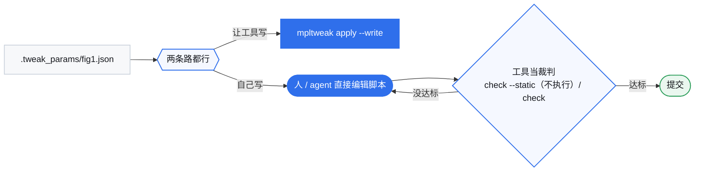

<div align="center">


# mpltweak

**像在 PPT 里调多图排版一样调 matplotlib，然后把参数写回你的代码。**

[](https://pypi.org/project/mpltweak/)
[](https://pypi.org/project/mpltweak/)
[](LICENSE)
[](https://github.com/shdbl/mpltweak/actions/workflows/tests.yml)

**中文** | [English](https://github.com/shdbl/mpltweak/blob/main/README.en.md)

</div>

## 目录
- [它解决什么问题](#它解决什么问题)
- [演示](#演示)
- [键位速查](#键位速查)
- [安装 + 快速开始](#安装--快速开始)
- [把它当作 skill 用](#把它当作-skill-用给-ai-客户端)
- [给 AI / agent 的排版接口](#给-ai--agent-的排版接口)
- [人 + agent 怎么分工](#人--agent-怎么分工)
- [原位改数字，还是插入调整块](#原位改数字还是插入调整块)
- [工作流](#工作流)
- [三层验证](#三层验证)
- [执行边界：哪些命令会跑你的脚本](#执行边界哪些命令会跑你的脚本)
- [不适用场景（先说清楚）](#不适用场景先说清楚)
- [真实绘图代码语料验证](#真实绘图代码语料验证)
- [参数文件](#参数文件)
- [开发](#开发)
- [License](#license)
## 它解决什么问题

调一张多面板图（multi-panel figure）时，麻烦通常出在排版而不是数据：挪一下子图，旁边的轴标签就被挡住；字号放大一点，图例又压到曲线上。而每改一次，都要重跑脚本、再看一遍图。

**mpltweak 的做法**：像在 PPT 里摆放图片那样直接拖，拖完把那几个数字写回源码。

| 方式 | 流程 |
|---|---|
| **传统方式** | 改一个数字 → 重跑脚本 → 等几十秒 → 看 PNG → 还是不对 → 再改 |
| **mpltweak** | 打开窗口 → 拖到位 → `mpltweak apply --write` → 那几个数字回到代码里 |

**写回是确定性的。** AST 精确定位；写回分两种方式：**代码里写的是字面量时，直接改那几个数字**（最干净，不插入任何东西）；**否则插入一个自包含的调整块**（不加 import、不改动你原有的逻辑）。两种方式都过三层验证（语法 / 重跑 / 语义），任一层不过即**回滚到批前状态**，备份留在 `.tweak_params/<脚本名>.tweak.bak`。

**要动源码，就必须做到确定性** —— 这是 mpltweak 的设计前提。

**它只管样式和位置，不发明内容** —— 文字、数据、图形仍完全由你的代码决定。

## 演示

<table>
<tr>
<td width="50%"><br>
<b>拖动 + 边缘吸附</b><br><sub>拖动时给出 ghost 预览与对齐参考线，靠近对齐位置自动贴合</sub></td>
<td width="50%"><br>
<b>多选对齐 / 均分</b><br><sub>Ctrl 加选三个面板 → 左对齐 + 垂直均分</sub></td>
</tr>
<tr>
<td><br>
<b>悬停改字号</b><br><sub>鼠标悬停标题、轴标签、刻度或图例，按 <code>+</code> / <code>-</code> 直接调</sub></td>
<td><br>
<b>线框模式提速（空格）</b><br><sub>cartopy 全球图全量重绘 <b>494ms → 169ms</b>，拖动不再卡顿</sub></td>
</tr>
</table>

**操作手势（与 PPT 类似）：** 拖动面板、Ctrl 多选、对齐 / 均分（Ctrl+Shift+L/R/T/B/C/M、H/V）、边缘吸附（带参考线）、Ctrl+F 适配画布裁白边、空格切线框模式、悬停改字号、图例吸附 8 个标准位、colorbar 调长度 / 厚度。

## 键位速查

| 操作 | 作用 |
|---|---|
| **`?`** | **打开 / 关闭键位帮助页**（画布内浮层：Esc 关闭，L 切换中英文） |
| 拖面板 / 拖边框、角 | 移动 / PPT 式缩放（对边固定；锁长宽比的轴自动等比） |
| **Ctrl+点击**（或 Shift+点击） | 多选加选 / 减选；拖空白处橡皮筋框选 |
| **Ctrl+Shift+L/R/T/B/C/M** | 对齐：左 / 右 / 上 / 下 / 水平居中 / 垂直居中 |
| **Ctrl+Shift+H / V** | 均分：水平 / 垂直（两端不动，中间等间距） |
| **Ctrl+Z** / **Ctrl+Y**（或 Ctrl+Shift+Z） | 撤销 / 重做 |
| 悬停文字后 `+` / `-` | 标题、轴标签、刻度、图例、colorbar 的字号 |
| **空格** | 线条模式（只留边框与文字，隐藏数据图元） |
| **Ctrl+F** | 适配画布到内容（裁掉四周白边，子图像素不变） |
| **方向键** / Shift+方向键 | 移动面板（PPT 习惯）/ 微调尺寸（中心不动） |
| 拖 colorbar 长轴端点 / 细条边 / 中点 | 调长度 / 调厚度 / 整条平移 |
| 拖图例 | 8 个标准位预览 + 松手吸附 |
| `[` `]` · `c` · `C` · `g` · `s` · `x` `y` | 线宽 / 线色 / colormap / 网格 / 边框 / 线性对数轴 |
| `n` · `e` | 吸附开关 / 手动导出 |
| 拖窗口边缘 | 改画布尺寸（写回 `figsize`） |

## 安装 + 快速开始

```bash
pip install mpltweak            # 核心：describe / check / apply（mcp 是可选适配层，见「给 agent 的通道」）
pip install "mpltweak[qt]"      # 要**开窗拖图**再加这个（装 PyQt5 图形后端）
```

开窗需要一个图形后端（推荐 PyQt5，约 +150MB），所以分成两步 —— 服务器 / headless / 纯 agent 场景只用 `describe` / `check` / `apply`，不该为此装一整套 Qt（有些环境本来也已经装了 PySide6 / PyQt6）。Windows / macOS 的官方 Python 安装包自带 `tkinter`，所以只装 `mpltweak` 一般就能直接开窗，此时用的是 **Tk 后端（交互弱化版）**，不是安装失败、也不是没装好；一个图形后端都没有时开窗 `rc=4` 并给出装哪个的提示。后端探测顺序、`doctor` 输出与常见问题见 [docs/exec-boundaries.md](docs/exec-boundaries.md)。

### 窗口后端：Qt（推荐）还是 Tk（默认可用）

装 `mpltweak[qt]` 走 Qt（交互最全）；只装核心包时用 Tk（弱化版，能开窗但手势不全）；两个后端都没有时开窗直接 `rc=4`，并提示该装哪一个。
后端对照表、各平台装法与环境变量见 [docs/exec-boundaries.md](docs/exec-boundaries.md)。

### 1 · 你原来的脚本，一行都不用改

```python
# fig1.py —— 就是平时写的 matplotlib
import matplotlib.pyplot as plt
import numpy as np

fig = plt.figure(figsize=(10, 8))
x = np.linspace(0, 1, 200)

ax1 = fig.add_axes([0.08, 0.66, 0.30, 0.21])      # 位置就是这几个数字
ax1.plot(x, np.sin(6 * x))
ax1.set_title('(a)')

ax2 = fig.add_axes([0.11, 0.38, 0.30, 0.21])      # 手写的数字，通常都不齐
ax2.scatter(np.random.rand(60), np.random.rand(60), s=8)

ax3 = fig.add_axes([0.05, 0.08, 0.30, 0.21])
ax3.hist(np.random.randn(300), bins=20)

fig.savefig('fig1.png', dpi=150)
```

不需要 `import mpltweak`，不需要任何钩子。

### 2 · 打开调图窗口

```bash
mpltweak fig1.py
```

> 子命令：`launch` / `apply` / `revert` / `describe` / `check` / `schema` / `mcp` / `doctor`。
> `mpltweak fig1.py` 与 `mpltweak launch fig1.py` 等价；除此之外，第一个参数一律按**脚本路径**解释。

窗口里：**拖**面板移动、拖**边 / 角**缩放、**Ctrl 加选**多个面板 → `Ctrl+Shift+L` 左对齐 / `Ctrl+Shift+V` 垂直均分、鼠标**悬停文字**按 `+` `-` 调字号、**空格**切线框（大图提速）、**Ctrl+F** 裁掉白边。按 **`?`** 随时打开键位帮助页；键位表与工作流图见 [docs/interaction.md](docs/interaction.md)。

**调完直接关窗。** 此时脚本一个字符都没变，参数落在 `.tweak_params/fig1.json`。

### 3 · 先看它打算改什么（只读）

```bash
mpltweak apply fig1.py
```

打印每个轴的位置、字号清单，不写任何文件。

### 4 · 写回

```bash
mpltweak apply fig1.py --write
```

```text
✓ 已原位写回: fig1.py
  原位修改 4 处: ax0.pos, ax1.pos, ax2.pos, ax3.pos
  备份: .tweak_params/fig1.tweak.bak
  ✓ Agg 重跑验证通过
  ✓ 语义验证通过（目标图状态 == 参数）
```

上面是**真实一次写回**的输出；其中"重跑 / 语义验证"是在**你的环境**里重跑脚本得到的（跑不起来或语义不符都会回滚，见「三层验证」）。

代码里写的是字面量时，它只改 `add_axes([...]` 里那几个数字；否则插入一个自包含的调整块。任何一步验证不过就自动回滚。

### 5 · 重跑看图

```bash
python fig1.py
```

### 如果没反应

没弹窗、写回后没变化、参数从哪来：先看 [docs/exec-boundaries.md](docs/exec-boundaries.md) 的「如果没反应」（含 `doctor`、`--timeout 600`、`--force-resume`、布局引擎冲突等逐条对照表）。


## 把它当作 skill 用（给 AI 客户端）

仓库里的 [`skills/mpltweak/SKILL.md`](skills/mpltweak/SKILL.md) 是写给 AI 的操作手册（Agent Skills 格式）：
命令、使用铁律、人机协作方式。放进客户端的 skills 目录（如 `~/.dsh/skills/`），或直接把内容贴给 AI 即可。

**它是怎么配合的**：AI 决定这张图要改成什么样（读 `describe` 的输出、改参数文件），
mpltweak 负责判断"到底改对了没有"（三层验证 + 出错回滚 + `revert`）——**不靠 AI 自己说"我改好了"**。
所以 mpltweak 本身不含任何 AI 模型，它只提供命令和判断；`--json` 输出的
`ok` / `reason` / `changes` / `pending` 就是给 AI 读的结构化结果。


MCP（可选适配层）与 JSON 契约见 [docs/agent.md](docs/agent.md)。

## 给 AI / agent 的排版接口

大模型能写出正确的绘图代码，但**排版数字基本靠猜**。mpltweak 把这部分从"猜"变成"写文件"：**参数文件是公开 JSON 格式（带 JSON Schema）**，agent 直接生成或修改它，`mpltweak apply --write` 负责落实。

```bash
mpltweak describe fig1.py -o layout.json   # 读：拿到当前排版（--all-figs 一次导出多张图）
mpltweak apply fig1.py --write --json      # 写：落回源码（--json 时过程信息全走 stderr）
mpltweak check fig1.py --json              # 查：排版体检，退出码即 CI 门禁
```

`--json` 给机器读：`files[]` 里的 `style` / `applied` / `changes` / `needs_block` / `pending` 判读这次落没落地；`schema` 子命令输出参数文件的 JSON Schema，供 agent 校验自己生成的内容。

四个子命令的作用表、退出码口径、读 → 改 → 写 → 查回路、以及 MCP 四个工具的参数签名见 [docs/agent.md](docs/agent.md)。

### 也可以接进 AI 客户端（MCP）——**可选适配层**

**能跑 shell 的客户端不需要 MCP**；它面向拿不到 shell 的客户端（如 Claude Desktop）。可选依赖（Python ≥ 3.10）：`pip install "mpltweak[mcp]"`，然后 `mpltweak mcp` 起 stdio server；客户端配置加 `{"mcpServers": {"mpltweak": {"command": "mpltweak", "args": ["mcp"]}}}`。
它暴露 CLI 的子集：`describe_layout` / `check_layout` / `params_schema` / `apply_layout`（`write=False`）；`revert`、`--style`、`--verify-fast`、`--strict` 等只在 CLI 上。四个工具的实际参数签名与 best-effort 维护策略见 [docs/agent.md](docs/agent.md)。

## 人 + agent 怎么分工

两种常见分工：**人拖 → agent 落盘**（你开窗拖完说一句"落盘"，AI 跑 `apply --write`）；**agent 起草 → 人微调**（先按规则排一版 → 你开窗接着调，参数会续上 → 确认落盘）。

原则：**"改哪个数字"可以交给 agent，"改完对不对"由产品判定**（`check` 与三层验证给出结论，失败回滚）。

其余三种协作方式（agent 自检 / 一张图当模板 / 人拖完 agent 总结）见 [docs/agent.md](docs/agent.md)。




## 原位改数字，还是插入调整块

以 `fig1.py` 为例。**动手前**（手写的数字，通常都不齐）：

```python
ax1 = fig.add_axes([0.08, 0.66, 0.30, 0.21])
ax2 = fig.add_axes([0.11, 0.38, 0.30, 0.21])
ax3 = fig.add_axes([0.05, 0.08, 0.30, 0.21])
```

**你拖完之后**（`mpltweak apply --write` 的结果）：

```diff
-ax1 = fig.add_axes([0.08, 0.66, 0.30, 0.21])
+ax1 = fig.add_axes([0.08, 0.655, 0.300, 0.215])
-ax2 = fig.add_axes([0.11, 0.38, 0.30, 0.21])
+ax2 = fig.add_axes([0.08, 0.380, 0.300, 0.215])
-ax3 = fig.add_axes([0.05, 0.08, 0.30, 0.21])
+ax3 = fig.add_axes([0.08, 0.085, 0.300, 0.215])
```

代码里写的就是字面量，所以**只动了这几个数字**：没有新增一行、没有加 `import`、没有引入任何依赖。字号、图例位置、网格、colorbar 同理，改的都是你代码里原本就有的参数。

位置来自 `plt.subplots()` / `plt.subplot(1,2,n)` / `GridSpec` 时，源码里没有数字可改。这种图改成**插入一个自包含的调整块**：

```python
# ===== auto layout (generated) - do not edit inside =====
# 本块由 mpltweak 自动生成于 2026-10-10 16:45（可手动微调，勿删上下两行标记）
# 轴身份（调图时）：ax0=网格[2, 2, 0, 0]，ax1=网格[2, 2, 0, 1]，…
for _ax, _p in zip(fig.axes, [
    [0.0728, 0.5363, 0.4418, 0.4015],
    [0.5394, 0.5363, 0.4418, 0.4015],
]):  # …网格四轴各自一段位置
    _ax.set_position(_p)
fig.axes[0].title.set_fontsize(12)
fig.axes[0].grid(False)
# ===== end auto layout =====
```

上下两行标记是**真写进你脚本的**，`grep auto layout` 就能定位。块是**自包含**的：不加 `import`、不依赖 matplotlib 之外的东西、不改你原有的逻辑；重复写回会**整体替换**它。想只走一条路：`--style inplace`（一处都不插块，写不了的字段 `rc=1` 明确失败）或 `--style block`（一律插块）。

逐字段三态判据（①已原位落地 ②与源码现值相等 ③有目标值、与现值不同、原位写不了）、"零侵入"的边界（`describe → apply` 直通会把整份状态钉进源码；想少改就少给）见 [docs/params.md](docs/params.md)；插入点硬约束（只允许在最后一个 `savefig` / `show` 之前，`anchor` / `attempts` 实测）、写回被整体拒绝与跨轮混用见 [docs/verify.md](docs/verify.md)。

### `--style` 与 JSON 字段：这次到底落没落地

`--style` 有两条路。`auto`（默认）能原位改就原位，改不了就退到插入调整块；`inplace`（显式）要求原位，改不了就 `rc=1` / `applied=false`，不假装都改好；`block` 一律插块。
判读落地情况看 `apply --json` 的 `files[]`：`needs_block`、`pending`、`inplace_pending` / `inplace_needs_block`、`auto_fallback`、`inplace_changes` / `inplace_reason`。
逐字段含义与三种风格的实测对照（rc / JSON）见 [docs/params.md](docs/params.md)。

## 工作流


从打开窗口到 `mpltweak apply --write`，中间任何一步（包括关窗之后）脚本一个字符都不会变；
写回是你在第三步显式点头后的动作。

## 三层验证

1. **语法层**（`layers.syntax`）：写盘后无条件 `ast.parse`，原位与块两条路径都做；语法错误当场回滚到批前状态。
2. **重跑层**（`layers.rerun`）：用 Agg 无头重跑；退出码非 0 时区分"脚本本身跑不通"与"写回把它改坏了"。
3. **语义层**（`layers.semantic`）：重跑后 dump 目标图状态，与参数里的位置 / 字号 / `grid` / `spines` / `clim` 等逐字段比对；判定不了时 `verified=null`，`detail` 里列出未判定字段。

任一层不过即回滚到批前状态；写回前的原文备份在 `.tweak_params/<脚本>.tweak.bak`。逐层细节与 `--verify-fast` / `--keep-unverified` 的关系见 [docs/verify.md](docs/verify.md)。

### 加速与门禁：`--verify-fast` 与 `--strict`

**`--verify-fast`（加速）**：只做写盘后的 `ast.parse`，所以快；它不证明脚本能跑通、也不证明布局真的落到目标图上（JSON 里 `verify_mode: "fast"`）。
**`--strict`（门禁）**：`check --strict` 把布局引擎冲突（`constrained_layout` / `autolayout`）从提示升级为问题（`rc=1`）；`apply --write --strict` 遇到冲突拒绝写回（要放行加 `--allow-layout-conflict`）。`check --json` 的 `ok` 字段 + 退出码可直接当 CI 用例；`check` 一次只接受一个脚本，批量要自己循环。
其余细节（`--no-verify` 的边界、`bbox_inches='tight'` 的降级、`--tol` 只收有限正数、`--static` 静态门禁、批量脚本示例）见 [docs/verify.md](docs/verify.md)。

### 后悔了：`mpltweak revert`

写回错了、或者拖完发现还是原来那版好看？不用去翻备份：

```bash
mpltweak revert fig1.py            # 只预览：会改回哪几行（默认，不动代码）
mpltweak revert fig1.py --write    # 真的回退到"上次写回之前"
```

它用的就是**参数文件旁边**那份备份（默认 `.tweak_params/<脚本>.tweak.bak`，每次
`apply --write` 之前自动留的）。写回时若用了 `--params`，回退也要带上同一个 `--params`，
否则会报 `[revert] 还没有可回退的备份`（`rc=2`）。
回退的是**最近一次**写回 —— 备份每次写回都被覆盖，反复写回后再 revert 回不到最早的原文。
**revert 自身也可逆**：覆盖前会把当前版本另存为 `<脚本>.revert.bak`（也在参数文件旁边），
所以手滑了还能再回去。
恢复是**字节级原样复制**（BOM / 换行 / 编码都不动）。

## 执行边界：哪些命令会跑你的脚本

`describe` / `check` / 开窗会**执行**你的脚本（都在**子进程**里、Agg 无头；退出码与全局状态都留在子进程内）；`apply` 只做 AST 改写，除非你要求**重跑验证**（`--write` 后默认重跑一次，`--verify-fast` 只做 `ast.parse`）。

退出码语义、脚本自己 `sys.exit()` 的影响、`--strict` 的 CI 用法，见 [docs/exec-boundaries.md](docs/exec-boundaries.md)。

## 不适用场景（先说清楚）

写回验证要在**你的机器上、用你的环境把整个脚本重跑一遍**——这是机制的一部分，不是可选步骤
（`--no-verify` 能跳过，但那等于关掉唯一的安全网）。所以下面这些脚本它帮不上忙：

| 脚本特征 | 为什么 |
|---|---|
| 跑一次要很久（分钟级以上） | 每次写回都要重跑；`--timeout 600` 只是放宽等待，不能免除 |
| 要读大数据 / 依赖重环境 / 要联网或凭据 | 无头重跑会卡住或失败 |
| 中途需要人工输入（`input()`、交互式选择） | 无头重跑直接堵死 |
| 需要在特定交互后端才有意义的图 | 验证固定用 Agg 无头后端 |

这类脚本走只读路线（`mpltweak describe` / `mpltweak check`，都不跑写回），或者手动改代码。
它的目标用户是**本地跑得动的小中型科研绘图脚本**。

## 真实绘图代码语料验证

本节是**用真实绘图代码跑出来的静态验证**。语料是 **10,158 份 sha256 唯一**的公开绘图脚本，来自真实项目：**Zenodo 数据集记录 6904 份**、
**GitHub 上的科研绘图仓库 2045 份**、若干项目的**官方 gallery 1209 份** —— 其中大量脚本是**不同论文的补充材料**。
实测只做**静态**定位与改写判定（**不执行**语料脚本，也**不再分发**；逐脚本的 URL / 许可 / sha256 在 manifest 里），
脚手架与逐脚本结论在 `bench/`。其中 **4,427 份**是绘图脚本（可静态分析 2,396 / 无图 1,940 / 语法错 90 /
1 份隔离重扫仍超时），下表的分母都来自这些脚本里的**可测站点**。

### 一、原位修改（直接改源码里的数字）

| 可调项 | 该族有站点的脚本 | 可原位到达的脚本 | 真原位写回（组合） | 通过率 |
|---|---:|---:|---:|---:|
| 画布尺寸 `figsize` | 2,256 | 2,256 | 2,247 | **99.6%** |
| 面板位置 `pos` | 131 | 94 | 93 | 98.9% |
| 标题字号 | 193 | 173 | 165 | 95.4% |
| 轴标签字号 x | 181 | 173 | 160 | 92.5% |
| 轴标签字号 y | 180 | 171 | 166 | 97.1% |
| 刻度字号 x | 189 | 91 | 88 | 96.7% |
| 刻度字号 y | 6 | 5 | 4 | 样本不足（n=5） |
| 网格 `grid` | 131 | 124 | 118 | 95.2% |
| 轴范围 `xlim` | 401 | 247 | 232 | 93.9% |
| 轴范围 `ylim` | 433 | 276 | 261 | 94.6% |
| **合计** | **4,101** | **3,610** | **3,531** | **97.8%** |

- **通过率 = 真原位写回 ÷ 可原位到达**（不是 ÷"源码里有这一项"）。
- **合计是各族的和**，同一脚本的不同族会各计一次，**不等于脚本数**。
- **承诺违约 = 0**：没有任何一行出现"工具声称原位写回、字节却没变"（本次语料静态判定范围内）。
- 没走成原位的分三类，逐脚本清单在 `bench/`：**参数非法被拒 37** · **证不出目标对象而拒绝落地 7** ·
  **改为追加块完成 3**（都不是静默丢改动）。

### 二、追加代码块（原位表达不了的改动）

有些排版项在源码里**没有可替换的字面量**：典型是 `plt.subplots()` 网格轴的位置，以及
`spines`（边框）、`xscale` / `yscale`（轴类型）、`clim`（色标范围）。这类项**改不了数字**，
mpltweak 的做法是：在目标对象**创建之后、被消费之前**（最后一个 `savefig` / `show` 之前）
追加一段**自包含的调整块**，块首尾各有一行显式标记（`# ===== auto layout (generated) ...` /
`# ===== end auto layout =====`），`revert` 可以整块移除。

这一节验证的就是**这些块到底可不可靠**：

| 判据 | 含义 | 本次全库（分母 = 走了块通道的脚本） |
|---|---|---|
| 块数 | 静态扫描里**真的插入了调整块**的脚本数 | **427** |
| 原文逐字节保留 | 块**以外**的原文一个字节不变（含行尾） | **427 / 427** |
| 不用运行期定位 | 块内不出现 `fig.axes[i]` / `plt.gca()` / `plt.gcf()` 这类**运行时才知道指向谁**的写法 | **427 / 427** |
| 作用到目标对象 | 块里的目标表达式**静态可证**（用变量名，或可枚举的 `plt.figure(n).axes[k]`） | **427 / 427** |
| 幂等 / 可撤销 | 再写一次不会重复插入；`revert` 能回到原件 | ✓ |

- **427 是"块通道的规模"**（脚本级）：全库 4,427 份绘图脚本里，有 427 份的改动走了插入块这条路。
  它**不是**下面第三节里那个 **3**（"本来能原位、工具却退了块"）—— 那个是**组合级**的能力缺口计数，两者口径不同。
- 本次**没有**对 427 个块做逐族拆分（即：多少块来自网格轴位置、多少来自 `spines` 等），报告里只给总量与判据通过率。
- 块通道**不参与第一张表（原位）的分母**：本次扫描的原位判定只覆盖那 10 个族；上面这些只能插块的项，
  **只在这一节里被验证**。

### 三、没到 100% 的那部分是什么

| 族 | 真原位 | 改为块落地 | 证不出而拒绝 | 参数非法被拒 |
|---|---:|---:|---:|---:|
| `figsize` | 2,247 | 0 | 0 | 0 |
| `pos` | 93 | 0 | 0 | 0 |
| 标题字号 | 165 | 1 | 0 | 1 |
| 轴标签字号 x | 160 | 0 | 1 | 11 |
| 轴标签字号 y | 166 | 0 | 1 | 0 |
| 刻度字号 x | 85 | 2 | 3 | 1 |
| 刻度字号 y | 4 | 0 | 1 | 0 |
| `grid` | 118 | 0 | 1 | 3 |
| `xlim` | 232 | 0 | 0 | 9 |
| `ylim` | 261 | 0 | 0 | 12 |
| **合计** | **3,531** | **3** | **7** | **37** |

- **改为块落地（3 例）不是失败**：改动落地了，只是走了追加块那条路。
- **证不出而拒绝（7 例）是刻意的**：静态判不出"改的是哪张图 / 哪条轴"就**不写盘**（`applied=false`、`pending` 非空），
  并打印可粘贴的手改片段。
- **参数非法被拒（37 例）**：测量脚手架按站点推出的参数越过了工具校验器的合法边界（例：轴序号越界、同图重名轴），
  工具拒绝是正确行为。**若把这 37 例从分母剔除，轴标签 x 的通过率是 160/161 ≈ 99.4%** ——
  这种剔法必须写明口径，所以两个数都列出来。

> 判定口径：全部为**静态层**（只做 AST 定位与改写判定，不执行语料脚本）。汇总结论：**97.8% 的改动原位落进源码（3,531 / 3,610），且没有一次"声称改了却没改"。**

## 参数文件

参数文件是**公开格式**，可以手工改，也可以让 AI / agent 直接生成，`--write` 一样能落实。顶层 `version` 标记格式版本（当前为 4）：

```jsonc
{ "version": 4, "script": "fig1.py",
  "axes": [ { "index": 0, "pos": [0.048, 0.655, 0.30, 0.215], "title_fontsize": 9.0 } ] }
```

**只写显式给出的字段**：参数里没写的字段不会写回。字段表（`figsize_px` / `figsize_in` / `aspect_locked` / `cell` / `clim` / `cmap` / `lines` / `legend` / `tick_fontsize_y` …）与两条约定（`axes[i]` 顺序、colorbar 槽轴不占序号）见 [docs/params.md](docs/params.md)。

## 开发

仓库结构：`src/mpltweak/`（`cli.py` / `launch.py` / `toolbox.py` / `params.py` / `apply.py` / `writeback.py` / `verify.py`）。跑测试：`python tests/test_writeback.py`（AST 写回 + 三层验证）。其余（安装、全部测试命令、模块职责、嵌入 API `from mpltweak.toolbox import gaitu`）见 [docs/dev.md](docs/dev.md)。

## License

MIT
