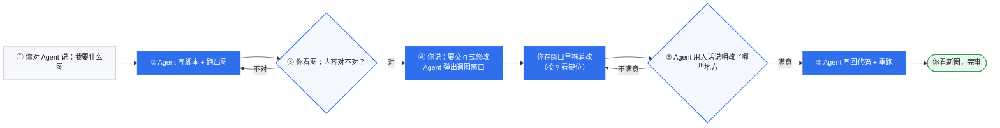

<div align="center">


# mpltweak

**像在 PPT 里调多图排版一样调 matplotlib，然后把参数写回你的代码。**

[](https://pypi.org/project/mpltweak/)
[](https://pypi.org/project/mpltweak/)
[](LICENSE)
[](https://github.com/shdbl/mpltweak/actions/workflows/tests.yml)

**中文** | [English](https://github.com/shdbl/mpltweak/blob/main/README.en.md)

</div>

## 它解决什么问题

调多面板图时，排版往往比数据更耗时：挪动子图导致轴标签被遮挡、字号调整导致图例重叠。每改一次都需要重跑脚本。

**mpltweak 的做法**：像在 PPT 中拖拽图片一样调整布局，并将参数写回源码。它只调整样式和位置，不改变内容（文字、数据、图形由代码决定）。

**零侵入**：不修改代码结构、不增加 `import`、不生成副文件。调整参数存放在 `.tweak_params/fig1.json`，仅在明确要求时写回 `.py`。

| 方式 | 流程 |
|---|---|
| **传统方式** | 改数字 → 重跑脚本 → 等待 → 查看 PNG → 循环 |
| **mpltweak** | 打开窗口 → 拖动调整 → 写回代码 |

演示：

<table>
<tr>
<td width="50%"><br>
<b>拖动 + 边缘吸附</b><br><sub>拖动时给出 ghost 预览与对齐参考线，靠近对齐位置自动贴合</sub></td>
<td width="50%"><br>
<b>多选对齐 / 均分</b><br><sub>Ctrl 加选三个面板 → 左对齐 + 垂直均分</sub></td>
</tr>
<tr>
<td><br>
<b>悬停改字号</b><br><sub>鼠标悬停标题、轴标签、刻度或图例，按 <code>+</code> / <code>-</code> 直接调</sub></td>
<td><br>
<b>线框模式提速（空格）</b><br><sub>cartopy 全球图全量重绘 <b>494ms → 169ms</b>，拖动不再卡顿</sub></td>
</tr>
</table>

## 两条路，挑一条

mpltweak 提供了一份 **Agent 手册（Skill）**，支持通过 Agent 自动完成操作。

- **路线 A：交给 Agent**：由 Agent 执行命令，你负责确认效果。
- **路线 B：自己敲命令**：手动执行命令。→ [跳到文末](#路线-b自己敲命令)

## 路线 A：交给 Agent

将以下指令发送给 Agent：

> 请帮我装一下 https://github.com/shdbl/mpltweak/blob/main/skills/mpltweak/SKILL.md 这个 skill，然后按里面的说明把 mpltweak 装好；装好之后先跑一下示例给我看效果。

### 先花两分钟看看效果

装好后，让 Agent 运行**示例**。它会生成一份示例脚本并打开调图窗口。你可以进行拖动、修改字号等操作。关闭窗口后，Agent 会列出修改内容并展示代码变更预览。确认无误后，让它将改动写回脚本并重跑，对比改前/改后图片。

### 日常使用流程

1. **让 Agent 帮你画图**（若已有脚本，直接指定脚本名，如 `fig1.py`）。
2. **确认图表内容**：坐标轴、标签、数据无误后再进行排版调整。
3. **发起交互式修改**：告诉 Agent "我要交互式修改"，它会弹出调图窗口。
4. **窗口内调整**：拖动面板、图例、调字号、对齐、均分（按 `?` 查看键位）。
5. **确认修改**：Agent 会列出修改清单（如“子图 (a) 移动，标题字号从 12 调至 14”）。
6. **写回代码**：确认后，Agent 将改动写回代码并重跑。



**窗口键位**：拖动 / 多选、对齐 / 均分、吸附、`Ctrl+F` 裁白边、空格线框提速、悬停文字后按 `+` / `-` 调字号、图例 8 个标准位、colorbar 调长 / 调厚、`Alt+点击` 穿透、`Tab` 循环同级元素。完整版见 [docs/interaction.md](https://github.com/shdbl/mpltweak/blob/main/docs/interaction.md)。

## 它会怎么改你的代码？三种结果

| 情况 | 处理方式 | 结果 |
|---|---|---|
| **源码包含该数字**<br>（`fig.add_axes([0.08, 0.66, 0.30, 0.21])`） | **原位修改数值** | 仅修改对应行，不插入额外代码 |
| **源码无对应数字**<br>（`plt.subplots()` / `GridSpec`） | **末尾追加自包含代码块** | 代码末尾增加 `auto layout` 标记块 |
| **无法定位目标**<br>（循环建轴、动态下标等；号牌不稳时它不猜） | **不修改** | 代码一个字节都不变，并给出一条改哪个符号、改成什么的定位说明 |

### 1. 能原位改的：直接改那一行

改前：

```python
fig = plt.figure(figsize=(10, 8))
ax1 = fig.add_axes([0.08, 0.66, 0.30, 0.21])
ax1.set_title('(a)', fontsize=12)
```

改后：

```python
fig = plt.figure(figsize=(10, 8))
ax1 = fig.add_axes([0.06, 0.68, 0.32, 0.23])   # ← 就改这几个数字
ax1.set_title('(a)', fontsize=15)              # ← 字号补在同一行末尾
```

**没有新增任何行，别处一个字不动。**

### 2. 不能原位改的：文件末尾追加一小段

改前（`subplots` 画的图，源码里没有能直接改的数字）：

```python
fig, axes = plt.subplots(1, 2, figsize=(10, 4))
axes[0].plot(np.arange(5), np.arange(5))
axes[0].set_title('(a)')
axes[1].plot(np.arange(5), np.arange(5) * 2)
axes[1].set_title('(b)')
fig.savefig('fig1.png', dpi=150)
```

改后（下面是真跑输出的原文，只有时间戳随生成时刻改变）：

```python
fig, axes = plt.subplots(1, 2, figsize=(10, 4))
axes[0].plot(np.arange(5), np.arange(5))
axes[0].set_title('(a)')
axes[1].plot(np.arange(5), np.arange(5) * 2)
axes[1].set_title('(b)')
# ===== auto layout (generated) - do not edit inside =====
# 本块由 mpltweak 自动生成于 <时间>（可手动微调，勿删上下两行标记）
# 轴身份（调图时）：ax0=网格[1, 2, 0, 0]，ax1=网格[1, 2, 0, 1]
axes[0].set_position([0.0800, 0.1500, 0.3800, 0.7500])
axes[1].set_position([0.5477, 0.1100, 0.3523, 0.7700])
axes[0].lines[0].set_linewidth(1.5)
axes[0].lines[0].set_color('#1f77b4')
axes[1].lines[0].set_linewidth(1.5)
axes[1].lines[0].set_color('#1f77b4')
# ===== end auto layout =====
fig.savefig('fig1.png', dpi=150)
```

### 3. 证明不了的：不写，但告诉 Agent 怎么改

改前（轴是循环建的）：

```python
fig = plt.figure(figsize=(8, 3))
for i, name in enumerate(['a', 'b', 'c']):
    fig.add_subplot(1, 3, i + 1).plot(np.arange(5), np.arange(5) * (i + 1))
    fig.axes[i].set_title(name)
fig.savefig('fig2.png', dpi=150)
```

它给出的是：

```text
· 保持原样: 块内只能按**静态可证的变量名**定位目标对象；这些字段证不出目标
  （没有可证的变量名，而运行期下标 fig.axes[i] / plt.gcf() 会写到别的轴或别的图上）
  → 按 fail-closed 处理，本次不写：ax0.lines、ax0.pos、ax1.lines、ax1.pos、ax2.lines、ax2.pos
```

这条提示是给 Agent 看的：它拿着"改哪个符号、改成什么"自己动手改源码，改完再跑一遍给你看。

## 它可靠吗？

1. **非写回模式下，代码保持原样**：仅在 `.tweak_params/` 写入参数。
2. **写回前预览**：可查看“动哪几行、从什么改成什么”。
3. **自动备份**：真写回时自动备份，支持一键撤回。
4. **安全机制**：无法证明的写法一律不写，避免错误修改。

每次写回自动执行三道检查：**语法解析** → **重跑验证** → **语义一致性**。任何一道检查未通过，自动回滚至写回前状态。

经 10,158 份真实科研绘图脚本、1,780 份真跑、13,000 次随机操作测试，未发生“说了改好、其实没改”的情况。

（静态差分语料共 **16,126 份** `.py` = 10,158 份第三方公开脚本 + 5,968 份本项目脚手架。）

完整样本分母、判据与逐族结果见 [docs/reliability.md](https://github.com/shdbl/mpltweak/blob/main/docs/reliability.md)；不适用场景与不声称项见 [docs/boundaries.md](https://github.com/shdbl/mpltweak/blob/main/docs/boundaries.md)。

## 路线 B：自己敲命令

### 安装

```bash
pip install mpltweak            # 核心：describe / check / apply
pip install "mpltweak[qt]"      # 要开窗拖图再加这个（装 PyQt5 图形后端）
```

```bash
mpltweak --version      # 版本
mpltweak --check-update # 查 PyPI 有没有新版本
```

**退出码**：`0` 成功 / `1` 检查发现问题或本次不写 / `2` 跑不起来 / `4` 没有可用图形后端。

> 后端对照表、各平台装法、`mpltweak doctor` 探测顺序与开窗失败处理 —— [docs/interaction.md](https://github.com/shdbl/mpltweak/blob/main/docs/interaction.md)。
> 哪些命令会执行脚本、退出码说明 —— [docs/exec-boundaries.md](https://github.com/shdbl/mpltweak/blob/main/docs/exec-boundaries.md)。

### 示例

```bash
mpltweak demo            # 生成 ./mpltweak-demo/ 并开窗；不写盘
mpltweak demo --write    # 写回示例脚本 + 重跑 + 生成 before.png / after.png
```

### 六步

```
cd 你的脚本目录
```

`fig1.py`（零侵入：不需要 `import mpltweak`）：

```python
# fig1.py —— 就是平时写的 matplotlib
import matplotlib.pyplot as plt
import numpy as np

fig = plt.figure(figsize=(10, 8))
x = np.linspace(0, 1, 200)

ax1 = fig.add_axes([0.08, 0.66, 0.30, 0.21])      # 位置就是这几个数字
ax1.plot(x, np.sin(6 * x))
ax1.set_title('(a)')

ax2 = fig.add_axes([0.11, 0.38, 0.30, 0.21])      # 手写的数字，通常都不齐
ax2.scatter(np.random.rand(60), np.random.rand(60), s=8)

ax3 = fig.add_axes([0.05, 0.08, 0.30, 0.21])
ax3.hist(np.random.randn(300), bins=20)

fig.savefig('fig1.png', dpi=150)
```

| 步 | 命令 | 说明 |
|---|---|---|
| **1 · 装** | `pip install mpltweak`<br>`pip install "mpltweak[qt]"` | 安装核心包及 PyQt5 后端 |
| **2 · 开窗拖** | `mpltweak fig1.py` | 调图窗口：拖动、缩放、调字号、切线框、裁白边 |
| **3 · 关窗** | —— | 参数存入 `.tweak_params/fig1.json`，脚本不变 |
| **4 · 预览** | `mpltweak apply fig1.py`<br>`mpltweak apply fig1.py --diff` | 预览参数或逐行 diff，不执行脚本、不写文件 |
| **5 · 写回** | `mpltweak apply fig1.py --write` | 原子写回、备份、重跑验证、语义比对 |
| **6 · 重跑看图** | `python fig1.py` | 查看最终效果 |

**写回机制**：基于 AST（语法树）解析，定位建图代码与位置参数，实现确定性重写。整个过程无 LLM 参与。

写回分两条通道：**源码字面量 ⇒ 原位改常量**；**否则在 `savefig`/`show` 前插入 `auto layout` 块**。两条通道均需通过语法解析、重跑、语义比对三道验证。

> 想看机器可读结果：`--json` 给 `files[].diff`、`preview_sha256`、`stage`、`next_step`、`attribution`。契约见 [docs/agent.md](https://github.com/shdbl/mpltweak/blob/main/docs/agent.md)。

> 界面语言跟随系统，可设 `MPLTWEAK_LANG=zh|en` 或加 `--lang en`。要把 `--lang` 传给脚本，请用 `--` 分隔：`mpltweak fig.py -- --lang en`。

> 卡住了见 [docs/troubleshooting.md](https://github.com/shdbl/mpltweak/blob/main/docs/troubleshooting.md)。
> 完整输出样张、逐处清单 `-v`、`--style` 参数、字段表 —— [docs/verify.md](https://github.com/shdbl/mpltweak/blob/main/docs/verify.md) 与 [docs/params.md](https://github.com/shdbl/mpltweak/blob/main/docs/params.md)。

## License

MIT

---

**要看完整版：** 键位与手势 [docs/interaction.md](https://github.com/shdbl/mpltweak/blob/main/docs/interaction.md) · 参数文件字段表 [docs/params.md](https://github.com/shdbl/mpltweak/blob/main/docs/params.md) · `--json` 冻结核对契约 [docs/json-contract.md](https://github.com/shdbl/mpltweak/blob/main/docs/json-contract.md) · 三道验证与备份 / `revert` [docs/verify.md](https://github.com/shdbl/mpltweak/blob/main/docs/verify.md) · 卡住了 [docs/troubleshooting.md](https://github.com/shdbl/mpltweak/blob/main/docs/troubleshooting.md) · 实测数字 [docs/reliability.md](https://github.com/shdbl/mpltweak/blob/main/docs/reliability.md) · 边界 [docs/boundaries.md](https://github.com/shdbl/mpltweak/blob/main/docs/boundaries.md) · 执行边界与退出码 [docs/exec-boundaries.md](https://github.com/shdbl/mpltweak/blob/main/docs/exec-boundaries.md) · 给 Agent 的手册 [docs/agent.md](https://github.com/shdbl/mpltweak/blob/main/docs/agent.md) 与 [skills/mpltweak/SKILL.md](https://github.com/shdbl/mpltweak/blob/main/skills/mpltweak/SKILL.md) · 开发与跑测试 [docs/dev.md](https://github.com/shdbl/mpltweak/blob/main/docs/dev.md)
