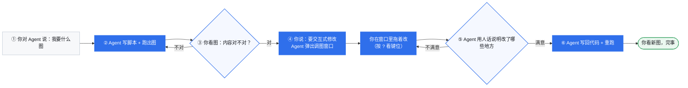

<div align="center">


# mpltweak

**像在 PPT 里调多图排版一样调 matplotlib，然后把参数写回你的代码。**

[](https://pypi.org/project/mpltweak/)
[](https://pypi.org/project/mpltweak/)
[](LICENSE)
[](https://github.com/shdbl/mpltweak/actions/workflows/tests.yml)

**中文** | [English](https://github.com/shdbl/mpltweak/blob/main/README.en.md)

</div>

## 它解决什么问题

调一张多面板图（multi-panel figure，就是一张画布里并排放好几张小图）时，麻烦通常出在排版而不是数据：挪一下子图，旁边的轴标签就被挡住；字号放大一点，图例又压到曲线上 —— 而每改一次，都要重跑脚本、再看一遍图。

**mpltweak 的做法**：像在 PPT 里摆放图片那样直接拖，拖完把那几个数字写回源码。它**只管样式和位置，不发明内容** —— 文字、数据、图形仍完全由你的代码决定。

| 方式 | 流程 |
|---|---|
| **传统方式** | 改一个数字 → 重跑脚本 → 等几十秒 → 看 PNG → 还是不对 → 再改 |
| **mpltweak** | 打开窗口 → 拖到位 → `mpltweak apply --write` → 那几个数字回到代码里 |

演示：

<table>
<tr>
<td width="50%"><br>
<b>拖动 + 边缘吸附</b><br><sub>拖动时给出 ghost 预览与对齐参考线，靠近对齐位置自动贴合</sub></td>
<td width="50%"><br>
<b>多选对齐 / 均分</b><br><sub>Ctrl 加选三个面板 → 左对齐 + 垂直均分</sub></td>
</tr>
<tr>
<td><br>
<b>悬停改字号</b><br><sub>鼠标悬停标题、轴标签、刻度或图例，按 <code>+</code> / <code>-</code> 直接调</sub></td>
<td><br>
<b>线框模式提速（空格）</b><br><sub>cartopy 全球图全量重绘 <b>494ms → 169ms</b>，拖动不再卡顿</sub></td>
</tr>
</table>

> 完整手势与键位速查（拖动 / 多选、对齐 / 均分、吸附、`Ctrl+F` 裁白边、空格线框、悬停改字号、图例 8 个标准位、colorbar 调长 / 调厚）见 [docs/interaction.md](https://github.com/shdbl/mpltweak/blob/main/docs/interaction.md)。

## 安装

所有命令都在**终端**里执行 —— Windows 用 cmd / PowerShell，macOS / Linux 用 Terminal；在 PyCharm 里是底部的 **Terminal** 面板（**不是** Python Console / 交互式解释器）。

```bash
pip install mpltweak            # 核心：describe / check / apply（mcp 是可选适配层，见「给 Agent 用」）
pip install "mpltweak[qt]"      # 要开窗拖图再加这个（装 PyQt5 图形后端）
```

第二条是为**开窗**装的：开窗需要一个图形后端（白话：让图能显示在一个可拖动窗口里的那套组件，推荐 PyQt5，约 +150MB）。只跑命令行（`describe` / `check` / `apply`）不用装。Windows / macOS 的官方 Python 自带 `tkinter`，所以只装 `mpltweak` 一般也能开窗，此时用的是 **Tk 后端（交互弱化版）**，不是安装失败、也不是没装好；一个图形后端都没有时开窗 `rc=4`（退出码 4，意思是"这台机器现在没有能画窗口的组件"）并给出该装哪个的提示。

> 后端对照表、各平台装法、`mpltweak doctor` 探测顺序与开窗失败逐条处理 —— [docs/interaction.md](https://github.com/shdbl/mpltweak/blob/main/docs/interaction.md)。
> 哪些命令会**执行**你的脚本、退出码怎么算 —— [docs/exec-boundaries.md](https://github.com/shdbl/mpltweak/blob/main/docs/exec-boundaries.md)。

## 5 分钟上手

调图前先 `cd` 到脚本所在目录：

```bash
cd 你的文件夹          # ← 换成你放 fig1.py 的那个目录（整行可复制）
```

示例脚本 `fig1.py`（纯 matplotlib，**一行都不用改**、不需要 `import mpltweak`、不需要任何钩子）：

```python
# fig1.py —— 就是平时写的 matplotlib
import matplotlib.pyplot as plt
import numpy as np

fig = plt.figure(figsize=(10, 8))
x = np.linspace(0, 1, 200)

ax1 = fig.add_axes([0.08, 0.66, 0.30, 0.21])      # 位置就是这几个数字
ax1.plot(x, np.sin(6 * x))
ax1.set_title('(a)')

ax2 = fig.add_axes([0.11, 0.38, 0.30, 0.21])      # 手写的数字，通常都不齐
ax2.scatter(np.random.rand(60), np.random.rand(60), s=8)

ax3 = fig.add_axes([0.05, 0.08, 0.30, 0.21])
ax3.hist(np.random.randn(300), bins=20)

fig.savefig('fig1.png', dpi=150)
```

**先说清楚它会做什么**：它会把**你的脚本跑一遍**（用你自己的环境、你自己的数据；mpltweak 自己不联网，也不改你的文件），然后把图显示在一个可以拖动的窗口里。**关掉窗口之前，你的 `.py` 一个字符都不会变** —— 拖出来的参数先落在 `.tweak_params/fig1.json`（一份纯文本的参数文件，记着你拖出来的位置和字号）。

| 步 | 命令 | 你会看到 |
|---|---|---|
| **1 · 装** | `pip install mpltweak`<br>`pip install "mpltweak[qt]"` | 核心包 + 让图能在窗口里打开的那个图形库；只跑命令行（`describe` / `check` / `apply`）不用装第二条 |
| **2 · 开窗拖** | `mpltweak fig1.py` | 调图窗口：**拖**面板改位置、拖**边 / 角**缩放、鼠标**悬停文字**按 `+` `-` 调字号、**空格**切线框提速、**Ctrl+F** 裁白边；按 **`?`** 出全部键位 |
| **3 · 关窗** | —— | 脚本**一个字符都没变**；参数落在 `.tweak_params/fig1.json`（没调好就再开窗接着调）。**真拖过东西**的话，关窗时终端会直接给你下一条可复制的命令，不用记 |
| **4 · 看它打算改什么** | `mpltweak apply fig1.py` | 逐轴列出位置与字号，并说明**改哪个数字 / 要不要插调整块 / 会不会拒绝**；只读，不执行脚本、不写文件 |
| **5 · 写回** | `mpltweak apply fig1.py --write` | **三段式：预览（只读，不执行脚本）→ 你确认 → 写回**；写回**自动备份**（`.tweak_params/fig1.tweak.bak`）、成功只报一行、**不满意一条命令就撤回**（`mpltweak revert fig1.py --write`） |
| **6 · 重跑看图** | `python fig1.py` | 图就是你拖完的样子；不满意：`mpltweak revert fig1.py --write` 退回写回前（先不带 `--write` 是预览） |

**写回是确定性的。** AST 会把你的代码拆成一棵"语法树"（按代码结构而非文本匹配来读），所以能精确定位那几个数字。写回分两条路：**代码里写的是字面量时，直接改那几个数字**（最干净，不插入任何东西）；**否则在文件末尾追加一段自包含的调整块**（术语叫"退块"：追加一段独立代码，不加 `import`、不改动你原有的逻辑）。两条路都要过**三层验证**（语法 / 重跑 / 语义：先看语法对不对，再把脚本真跑一遍，最后核对图上的位置字号和你拖出来的是不是一致），任一层不过**默认回滚**（退回改动前的样子，`--keep-unverified` 可保留但需自己验证）。

**图是用 `plt.subplots()` / `GridSpec` 画的？** 源码里往往没有能直接改的数字，那就走"追加调整块"这条路，不满意用 `mpltweak revert fig1.py --write` 一键删掉；你原来写的代码一行都没被改写。

> 卡住了见 [docs/troubleshooting.md](https://github.com/shdbl/mpltweak/blob/main/docs/troubleshooting.md)（拖了没反应 / 拖了弹回去 / 报错怎么办，每条都是「现象 → 一句话原因 → 怎么做」）。

> **更多细节**：一次真实写回的完整输出样张、逐处清单 `-v`、`--style inplace` / `--style block` 两条单行路、调整块长什么样（`auto layout` 标记）、参数文件字段表 —— [docs/verify.md](https://github.com/shdbl/mpltweak/blob/main/docs/verify.md) 与 [docs/params.md](https://github.com/shdbl/mpltweak/blob/main/docs/params.md)。

## 它可靠吗

我们做过三类测试：**静态判定** —— 拿 **10,158 份公开绘图脚本**（真实科研绘图代码，按 sha256 唯一）逐份判定这次改动能不能**原位落进源码**，全程不执行；**真跑验证** —— 把 **1,780 份**脚本真的跑起来，核对写回后仍能出图、且图上位置字号与拖出来的参数一致；**随机操作压窗口交互** —— 离屏矩阵实跑 **13,000 次**（每次操作后都校验），真窗口 **6,000 次手势 + 27 条硬断言**。下面是实测结果（完整版见 [docs/reliability.md](https://github.com/shdbl/mpltweak/blob/main/docs/reliability.md)）：

| 层 | 测试内容 | 测试结果 |
|---|---|---|
| 静态语料（**不执行**脚本） | **测的是**：改动能不能**原位落进源码**（找得到目标、只动目标、语法不变）<br>**样本**：10,158 份脚本 → 其中 **4,427 份是绘图脚本** → **可测站点 4,101**（其中**可原位到达 3,610**） | **该落回原位的**成功率 **97.8%**（3,531 / 3,610）；**该追加代码块的**成功率 **100%**（427 / 427，判据＝块外原文逐字节保留 · 不用运行期定位 · 静态可证作用到目标对象）；**其余 79 例逐一归类、五类之和 = 3,610**：**走块通道 10**（真的落地 3 · 改走块但没落地 7）· **参数非法被拒 37** · **原始记录里缺该族条目 32**（流水线的记录缺口，不是"跳过"这类产品行为）；承诺违约 **0** |
| 全量真跑（**真的重跑**脚本） | **测的是**：写回后脚本还跑得通、图还出得来、图上位置字号与参数一致<br>**样本**：池 **1,837 份** → **真跑候选 1,780 份**（= 1,837 − 28 份静态已知"要开窗" − 29 份静态已知"联网 / 子进程"） | **该写回并验证通过的** **928 份**，四条铁律（幂等 / 可逆 / 语法守恒 / 只动目标）**逐律 928 / 928**；其余 **852 份未判定、不是失败**（需开窗 317 · 等人输入 464 · 撞 90 s 超时 71；928 + 852 = 1,780）；写回不篡改：1,837 份**违约 0** |
| 窗口交互（随机操作 + 真窗口） | **测的是**：随机操作下**不崩 / 往返一致 / 几何合法 / 落位与参数一致**<br>**样本**：离屏 **12 种图形 × 1,000 次**（实跑 13,000 次，每次操作后都校验）；真窗口 **6 种图形 × 1,000 次 = 6,000 次手势** | 离屏：**该通过的不变量校验 100%**（13,000 / 13,000）；专项操作断言 **100%**（356 / 356，另有 47 条不适用、逐条带理由）；真窗口硬断言 **100%**（27 / 27）；两编码（UTF-8 / GBK）均 ALL PASS |

**"承诺违约"** = 工具说"已写回 / 已验证"，但实际字节没变、或验证根本没做 —— 本版为 **0**。（静态层的做法：真的把公开绘图脚本拿来做定位与改写判定；交互层的判据不是"看起来对"，而是随机操作下核对不崩 / 往返一致 / 几何合法 / 落位与参数一致。）

> 完整版（逐族通过率表、块通道判据、真窗口两轮日志、以及"没到 100% 的那部分是什么"）—— [docs/reliability.md](https://github.com/shdbl/mpltweak/blob/main/docs/reliability.md)。
> 它**不声称什么**（不适用场景 / 验证的不声称项 / 语料数字怎么来的）—— [docs/boundaries.md](https://github.com/shdbl/mpltweak/blob/main/docs/boundaries.md)。

## 给 Agent 用

**你不需要懂命令行 —— 把这件事交给 Agent 就行。**（自己敲命令也行：拖一下就到位，**不用手写那些位置数字**。）
（**要能直接读写你电脑上文件的那种 Agent**；只在网页聊天窗口里聊天的，做不到。）

把下面这条链接发给你正在用的 Agent（Claude / ChatGPT / Cursor / DeepSeek 等，只要它能读写你电脑上的文件），
它自己就会照着这份手册把环境配好、帮你调图：

- **给 Agent 的操作手册**：https://github.com/shdbl/mpltweak/blob/main/skills/mpltweak/SKILL.md
  （也可以让它打开仓库里的 `skills/mpltweak/SKILL.md`，或者把那份文件的内容直接贴给它。）

### 首推流程：六步（照着跟 Agent 说就行）

1. **让 Agent 帮你画图。** 你只用说你要什么（"把这两组数据画成对比柱状图"），脚本和图都由 Agent 来写、来跑。
   *你会看到*：Agent 把画好的图贴给你看。
2. **先确认图的内容对不对**（这一步别急着调排版）。坐标轴、标签、数据是不是你要的？不对就现在说，让 Agent 改。
   *你会看到*：内容定稿的版本 —— 后面要调的只是"排版"，不是"画什么"。
3. **跟 Agent 说一句"我要交互式修改"。** 它会自己把调图窗口弹出来（你不用装东西、也不用打任何命令）。
   *你会看到*：一个窗口弹出来，里面就是你的图，可以用鼠标拖、缩放。
4. **你在窗口里改。** 拖面板、拖图例、调字号、对齐、均分（**在窗口里按 `?`，随时调出全部键位说明**）。
   *你会看到*：拖动时是半透明预览，松手才落位。
5. **Agent 用人话告诉你它改了什么，并等你确认。** 比如"子图 (a) 往右挪了一点、标题字号从 12 调到 14"。
   这一步**代码还没动** —— 你不同意就继续说，它接着改。
   *你会看到*：一份"改了什么"的人话清单 + 一句"要不要写进代码？"
6. **你说"可以"，Agent 才把改动写回代码，然后重跑给你看。** 重跑之后对着第 2 步的内容再看一眼，确认没被改坏。
   *你会看到*：重跑出来的新图 + 它改了哪几处；不满意可以接着调，或者让它退回上一次（`revert`）。

> **全程你不需要打开命令行、不需要记任何命令** —— 你只需要看图 + 说话。



**技术指针（都在仓库的 `docs/` 里）**：MCP（可选适配层）与 JSON 契约、**读 → 改 → 写 → 查的三行命令**、四个子命令的作用表与退出码、MCP 四个工具的参数签名、**人 + agent 的几种分工**，以及**排版前要先看的布局引擎冲突**，都在 [docs/agent.md](https://github.com/shdbl/mpltweak/blob/main/docs/agent.md)。

## License

MIT

---

**要看完整版：** 键位与手势 [docs/interaction.md](https://github.com/shdbl/mpltweak/blob/main/docs/interaction.md) · 参数文件字段表 [docs/params.md](https://github.com/shdbl/mpltweak/blob/main/docs/params.md) · 三层验证与备份 / `revert` [docs/verify.md](https://github.com/shdbl/mpltweak/blob/main/docs/verify.md) · 卡住了 [docs/troubleshooting.md](https://github.com/shdbl/mpltweak/blob/main/docs/troubleshooting.md) · 实测数字 [docs/reliability.md](https://github.com/shdbl/mpltweak/blob/main/docs/reliability.md) · 边界 [docs/boundaries.md](https://github.com/shdbl/mpltweak/blob/main/docs/boundaries.md) · 执行边界与退出码 [docs/exec-boundaries.md](https://github.com/shdbl/mpltweak/blob/main/docs/exec-boundaries.md) · 给 Agent 的手册 [docs/agent.md](https://github.com/shdbl/mpltweak/blob/main/docs/agent.md) 与 [skills/mpltweak/SKILL.md](https://github.com/shdbl/mpltweak/blob/main/skills/mpltweak/SKILL.md) · 开发与跑测试 [docs/dev.md](https://github.com/shdbl/mpltweak/blob/main/docs/dev.md)
