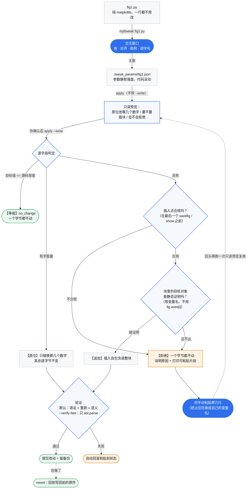

# 交互速查

## 键位速查

窗口里按 **`?`** 随时打开 / 关闭这份键位帮助页（画布内浮层：`Esc` 关闭，`L` 切换中英文）。

| 操作 | 作用 |
|---|---|
| **`?`** | **打开 / 关闭键位帮助页**（画布内浮层：Esc 关闭，L 切换中英文） |
| 拖面板 / 拖边框、角 | 移动 / PPT 式缩放（对边固定；锁长宽比的轴自动等比） |
| **Ctrl+点击**（或 Shift+点击） | 多选加选 / 减选；拖空白处橡皮筋框选 |
| **Alt+点击** | **逃生①：穿透到下一层** —— 光标下叠着多个面板、点不到下面那个时用它；**继续点继续轮转**（提示条会报「穿透选中 axN（候选 M 个）」） |
| **Tab** | **逃生②：循环同级元素** —— 在**整张图的子图之间**轮转选中（按创建顺序、到底回到第一个）；被压住、或者点在了轴外的位置，也能走到 |
| **Ctrl+Shift+L/R/T/B/C/M** | 对齐：左 / 右 / 上 / 下 / 水平居中 / 垂直居中 |
| **Ctrl+Shift+H / V** | 均分：水平 / 垂直（两端不动，中间等间距） |
| **Ctrl+Z** / **Ctrl+Y**（或 Ctrl+Shift+Z） | 撤销 / 重做 |
| 悬停文字后 `+` / `-` | 标题、轴标签、刻度、图例、colorbar 的字号 |
| **空格** | 线条模式（只留边框与文字，隐藏数据图元） |
| **Ctrl+F** | 适配画布到内容（裁掉四周白边，子图像素不变） |
| **方向键** / Shift+方向键 | 移动面板（PPT 习惯）/ 微调尺寸（中心不动） |
| 拖 colorbar 长轴端点 / 细条边 / 中点 | 调长度 / 调厚度 / 整条平移 |
| 拖图例 | 8 个标准位预览 + 松手吸附 |
| `[` `]` · `c` · `C` · `g` · `s` · `x` `y` | 线宽 / 线色 / colormap / 网格 / 边框 / 线性对数轴 |
| `n` · `e` | 吸附开关 / 手动导出 |
| 拖窗口边缘 | 改画布尺寸（写回 `figsize`） |

**操作手势（与 PPT 类似）**：拖动面板、Ctrl 多选、对齐 / 均分（`Ctrl+Shift+L/R/T/B/C/M`、`H/V`）、边缘吸附（带参考线）、`Ctrl+F` 适配画布裁白边、空格切线框模式、悬停改字号、图例吸附 8 个标准位、colorbar 调长度 / 厚度。

### 点不到某个面板怎么办（逃生两招）

两种面板**完全重合**（一张压在另一张上、colorbar 压在轴上、极地图的圆形区域外露着边框）时，鼠标按下只能命中"最上面那个"，这是几何决定的，不是工具选错了。`?` 键位表里专门有一组 **逃生**：

| 招式 | 怎么用 | 什么时候用 | 你会看到 |
|---|---|---|---|
| **Alt+点击** | 按住 `Alt` 再点那个位置 | 想在**光标下的几个面板之间**挑一个（只影响"这次按下选中谁"，不动位置、不改参数） | 提示条「穿透选中 axN（候选 M 个）」；**继续点会继续轮转**，转一圈回到原点 |
| **Tab** | 直接按 `Tab` | 完全点不到（被压死 / 位置在轴外 / 想按顺序过一遍） | 提示条「Tab 循环：axN / M」，按**创建顺序**逐个走到，到底回到第一个 |

两招的边界写清，免得当成万灵药：

- **Alt+点击只推一层选择，不"全选"**：它把当前选中换成候选里的**下一个**，重复按就是轮转；要加选仍用 `Ctrl+点击` / `Shift+点击`。
- **Alt+点击不接管已有手势**：colorbar **长轴端点**上的 `Alt+按下` 仍是"Alt+拖端点 = 中心对称调长度"的老手感，不会被当成穿透。
- **`Tab` 轮的是整张图的子图**（`fig.axes` 的顺序），不是光标附近那几个；选中一个之后再拖 / 方向键，与鼠标选中完全一样。
- 极端情况（图例 `fig.legend()` 不挂在任何子图上）两招也救不了 —— 那种图例本工具不接管（见下方"如果没反应"）。

## 工作流



从打开窗口到 `mpltweak apply --write`，中间任何一步（包括关窗之后）脚本一个字符都不会变；
写回是你在第三步显式点头后的动作。

关窗时如果**真的拖过东西**（参数确实存下来了），终端会直接打出下一条命令，照抄即可：

```text
[launch] 参数已存到 .tweak_params/fig1.json（脚本未改动）；要写回源码：
  mpltweak apply fig1.py --write
```

只是把命令**打出来**：写回仍然要你自己跑、自己确认，工具**不会**自动改你的源码。
没拖过（参数与打开时一模一样）时不会打这一段 —— 没有改动就没有下一步。

## 窗口后端：Qt（推荐）还是 Tk（默认可用）

开窗必须有一个图形后端。mpltweak 依次尝试 **QtAgg（需要 PyQt5）→ Qt5Agg → Qt6Agg（PyQt6 / PySide6）→ TkAgg（需要 `tkinter`）**，用第一个 import 得动的：

| 你的环境 | 实际用的后端 | 体验 |
|---|---|---|
| `pip install "mpltweak[qt]"` | Qt（QtAgg + PyQt5） | **推荐**：交互最全；**真实开窗实测**走的就是 Qt 路径（自动化套件用离屏 / Agg 合成事件，不覆盖真窗口） |
| 只 `pip install mpltweak`（系统有 `tkinter`） | **Tk（TkAgg）** | 能开窗、能拖，功能基本都在，但重绘与悬停提示是弱化版 |
| 一个都没有 | —— | 开窗 `rc=4` 并给出装哪个的提示（见下方注） |

> 一个后端都没有时（典型：Linux 服务器没装 `python3-tk`）：开窗 `rc=4`，并提示
> `pip install "mpltweak[qt]"`（推荐），或"Linux 也可以用系统包管理器装 `python3-tk`"。
> **纯 CLI 用法（`describe` / `check` / `apply`）一个图形后端都不需要**；`mpltweak mcp` 走 stdio，同样不需要。

不确定现在用的是哪个：

```bash
mpltweak doctor        # 打印 backend 探测（QtAgg / TkAgg 哪个 OK）与 Qt 绑定
```

想要开窗就补一句：

```bash
pip install "mpltweak[qt]"
```

> 命令不在 PATH 时（例如用 `pip --user` 装的，或 Windows + conda 下 `Scripts` 没进 PATH —— 安装时会打一行
> `WARNING: The script mpltweak.exe is installed in '…\Scripts' which is not on PATH`），把本文的 `mpltweak`
> 换成 `python -m mpltweak` 即可，用法完全一样；也可以直接用全路径 `<环境>\Scripts\mpltweak.exe`，
> 或把那个目录加进 PATH（改完重开终端）。

---

回退到 Tk 时工具会在 **stderr** 打一句人话提示，并按顺序
QtAgg → Qt5Agg → Qt6Agg → TkAgg 逐个真建 canvas 探测；`doctor` 会多报一行当前开窗后端
（实测：`开窗后端   : Tk（未装 Qt；想要 Qt 界面：pip install "mpltweak[qt]"）`）。

这句提示**每个用户只打一次**（0.1.10 起）：第一次用 Tk 开窗时提醒，之后不再重复念，
免得每次开窗都刷一行。它记在一个戳文件里：

```text
~/.mpltweak/tk_hint_shown          # 家目录可用 MPLTWEAK_HOME 改
```

想再看一次那条提示：删掉这个文件即可。`MPLTWEAK_NO_HINT=1` 是"这次别说话"
（静默，且**不落戳** —— 批量脚本里用它，下次你手敲时仍会提示一次）。

> **"怎么装 Qt"没有被藏起来**：`mpltweak doctor` 的「开窗后端」那行**永远**照打
> （不是每个用户一次，是每次都报），本节也一直写着 `pip install "mpltweak[qt]"`。

## 如果没反应

一般用不到这一节；遇到异常再对照下表。

| 现象 | 处理 |
|---|---|
| 没弹窗 | 运行 `mpltweak doctor` 看诊断 |
| 敲了 `mpltweak launch fig1.py` | 现在这两种写法等价（`launch` 是显式子命令），参数与 `mpltweak fig1.py` 完全相同 |
| `revert` 说"还没有可回退的备份" | 这条报错的含义是"这份备份不存在"：还没对这个脚本做过 `apply --write`，或者备份被删过。备份**恒定留在脚本旁**的 `.tweak_params/<脚本>.tweak.bak`（锚点是**脚本**，**不跟 `--params` 走**）⇒ `revert` **不用**再传 `--params`；0.1.8 遗留在参数文件旁的旧备份会作为兜底被找到。**例外（0.1.14 起自动兜底）**：固定名那份被删、只剩 `<脚本>.tweak.<pid>.bak` 时**不再报错** —— 默认 `revert` 自动退回最早那份专属副本（`rc=0`、逐字节回到最初；`--json` 里 `backup` 指向那份 pid 副本并带 `fallback: "no_fixed_backup_used_oldest_pid"`）。真的一份备份都没有（固定名与 pid 副本两处都缺）才报这句，`error_code` 为 `no_backup` |
| 想从头调 | 删掉 `.tweak_params/fig1.json`（不删就是接着上次续调） |
| 多图脚本 | 每张图都会弹窗，**改哪张记哪张**；`mpltweak apply` 逐张写回 |
| 脚本要读数据 / 跑很久 | **开窗那一步没有超时开关**（本进程直接跑，等多久就是多久）；`apply --write` 的重跑验证可以 `--timeout 600` **放宽**等待（默认 300 秒；`check` / `describe` 不接受 `--timeout`）。`--no-verify` 会**完全跳过重跑验证**——那是写坏代码时唯一的自动安全网，只在脚本确实无法在无头环境重跑时才用，且用前请确认脚本已在版本控制里 |
| **拖动特别卡** | 按 **空格** 切线框模式：只画边框、坐标轴和文字，**不渲染数据图元**（cartopy 大图实测 494ms → 169ms），挪完再按一次空格恢复 |
| 手动改过代码后再开窗 | 会自动**不套用**上次参数（避免静默覆盖你的改动）并给出提示；确要接着上次调，加 `--force-resume` |
| 脚本里开着 `constrained_layout` / `autolayout` | 开窗时提示（**带行号**）：布局引擎在每次绘制时重算轴位置，拖拽/写回的位置会被它覆盖。调图前先关掉（或把要精调的轴改成 `add_axes([...])`，引擎不管这类轴）。**`apply --write` 会硬拦**：冲突 + 这次要写轴位置 ⇒ 默认拒绝写回（不写盘、`rc=1`，stderr 给两条出路）；只写字号/线宽/cmap 这类非几何字段照旧放行；确要写就加 `--force`（输出里会声明"已按 --force 跳过"） |

### `doctor` 的选项口径

- `mpltweak doctor` **不接受其它选项，也不接受位置参数**（多余参数 ⇒ **rc=2**，usage 走 stderr）—— 与其它子命令一致，不再静默忽略。
- **`doctor` 没有 `--json`**：它的输出是给人看的自检结果，不产出机器可读载荷；给了 `--json` ⇒ **rc=2** 且明确说明（**明拒，不静默忽略**）。
- `-h` / `--help` ⇒ rc=0，打印 doctor 用法。
