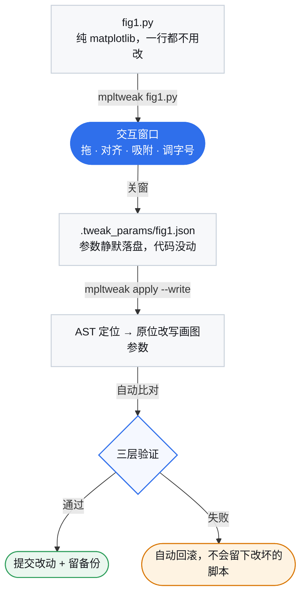

# 键位速查与工作流

> 本文件是 [README](../README.md) 的展开版，内容自 README 搬出；命令、参数、退出码与实测数值与原文一致。

## 键位速查

| 操作 | 作用 |
|---|---|
| **`?`** | **打开 / 关闭键位帮助页**（画布内浮层：Esc 关闭，L 切换中英文） |
| 拖面板 / 拖边框、角 | 移动 / PPT 式缩放（对边固定；锁长宽比的轴自动等比） |
| **Ctrl+点击**（或 Shift+点击） | 多选加选 / 减选；拖空白处橡皮筋框选 |
| **Ctrl+Shift+L/R/T/B/C/M** | 对齐：左 / 右 / 上 / 下 / 水平居中 / 垂直居中 |
| **Ctrl+Shift+H / V** | 均分：水平 / 垂直（两端不动，中间等间距） |
| **Ctrl+Z** / **Ctrl+Y**（或 Ctrl+Shift+Z） | 撤销 / 重做 |
| 悬停文字后 `+` / `-` | 标题、轴标签、刻度、图例、colorbar 的字号 |
| **空格** | 线条模式（只留边框与文字，隐藏数据图元） |
| **Ctrl+F** | 适配画布到内容（裁掉四周白边，子图像素不变） |
| **方向键** / Shift+方向键 | 移动面板（PPT 习惯）/ 微调尺寸（中心不动） |
| 拖 colorbar 长轴端点 / 细条边 / 中点 | 调长度 / 调厚度 / 整条平移 |
| 拖图例 | 8 个标准位预览 + 松手吸附 |
| `[` `]` · `c` · `C` · `g` · `s` · `x` `y` | 线宽 / 线色 / colormap / 网格 / 边框 / 线性对数轴 |
| `n` · `e` | 吸附开关 / 手动导出 |
| 拖窗口边缘 | 改画布尺寸（写回 `figsize`） |

## 工作流

从打开窗口到 `mpltweak apply --write`，中间任何一步（包括关窗之后）脚本一个字符都不会变；
写回是你在第三步显式点头后的动作。
